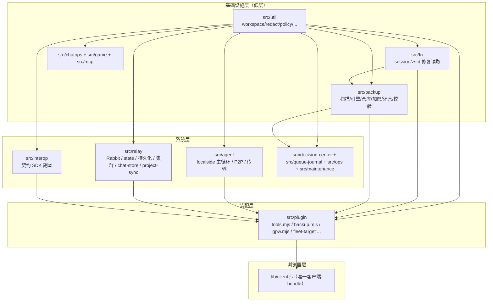
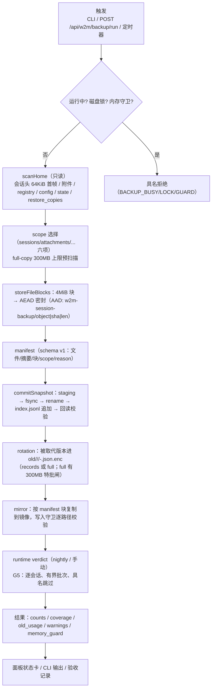
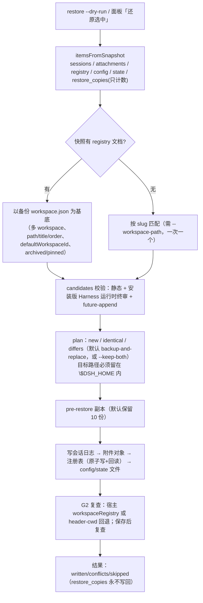
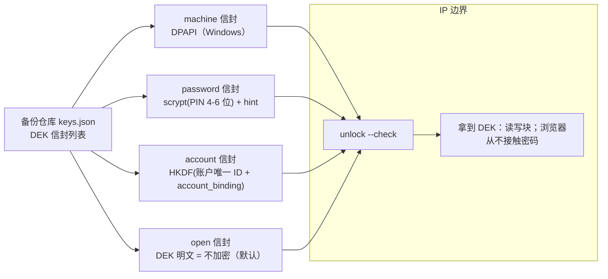
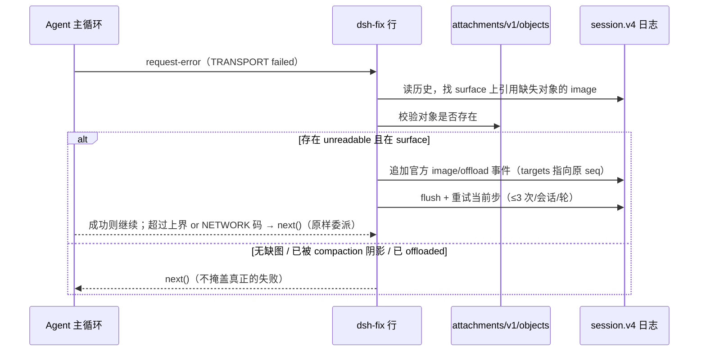
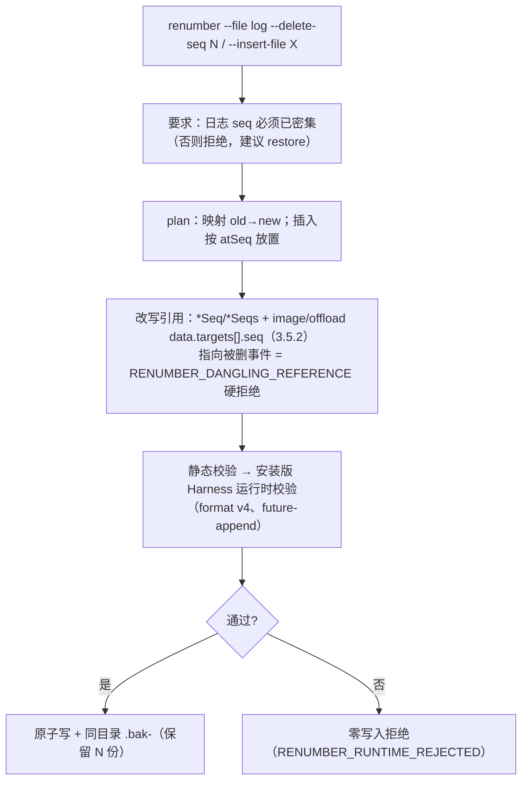
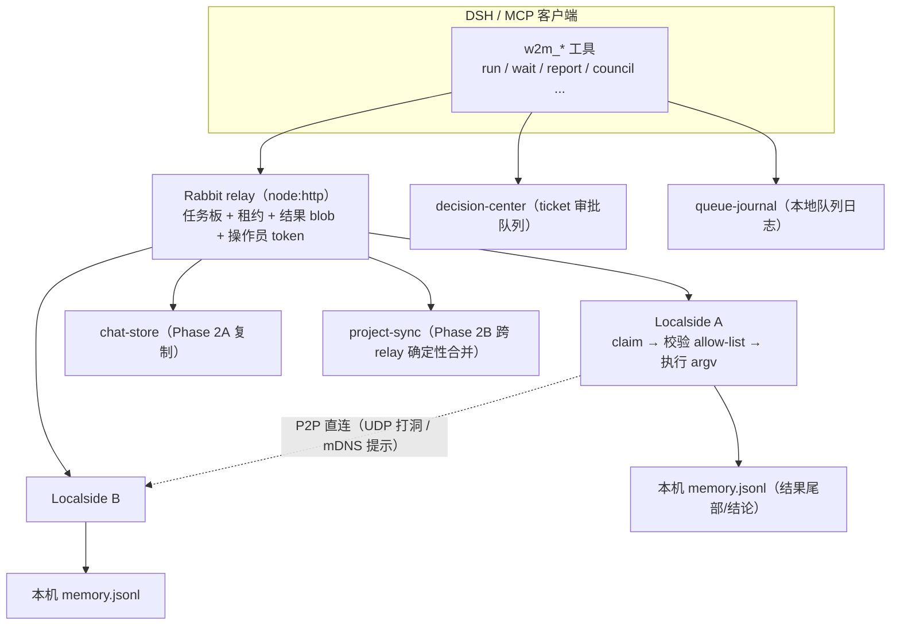
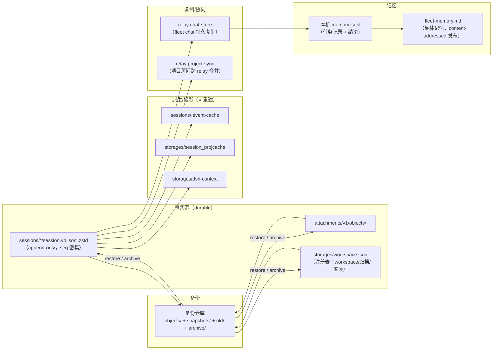

# w2m DSH 插件全面评估（3.5.2 / HEAD 462794e）

> 评估对象：`TwinsEarth/dsh-windows2macos`（w2m Windows2MacOS DSH 插件），主开发目录 `E:\GPT\w2m\w2m-345-fresh`，
> 版本 **3.5.2**（HEAD `462794e`，tag `v3.5.2`，npm 3.5.2 处于 staged 待批准）。
> 方法：对仓库做全量文件清点（902 个受控文件）+ 模块头注释/导出面/内部依赖扫描 + 关键路径人工复核 + 既有验收与性能数据；
> 图表使用 Mermaid（GitHub/VS Code 可直接渲染）。本文是**评估报告**，不改变任何代码。

---

## 0. 结论摘要（先看这 10 条）

1. **形态**：这不是一个"小工具插件"，而是一个 22 万行代码（含测试）的**分布式执行 + 治理 + 备份**平台型 DSH bundle：
   8 个 Cordis 行（`w2m` + 7 个子插件）、18 个 `w2m_*` 工具、15 个 CLI bin、16 个包导出子路径。
2. **架构分层清晰**：`util／fix／backup／chatops`（基础设施层）→ `agent／relay／interop／decision-center／queue-journal`（系统层）
   → `plugin`（装配层）→ `lib/client.js`（浏览器层）。`scripts/layer-check.mjs` 把"跨层边"做成门禁，这是本仓库最值钱的架构约束。
3. **最大文件是入口**：`src/plugin/tools.mjs` 8.9k 行、`src/agent/agent.mjs` 4.8k、`src/relay/state.mjs` 3.7k、
   `lib/client.js` ~10k —— 四处合计占代码量约 12%，且都是"行为变更即契约变更"的位置。
4. **备份子系统是当前质量最高的部分**：协议冻结（manifest v1 + AAD 身份字符串）、六 scope、覆盖率报告、
   G4 重编号、G5 运行时终审、P0–P3 扩围、3.5.1 内存有界化，全部有测试与真机证据链（`docs/acceptance`）。
5. **3.5.0 的 OOM 事故暴露了"mount 即可执行重活"的架构风险**：3.5.1 已把 mount 惰性化（`backupCatchUpOnStart=false`）
   并加了内存守卫；**仍未做**的是把引擎迁到 worker_threads（运行期间 GUI 可能变慢）。
6. **测试规模 318 个测试文件（307 个 .test.mjs）/ 约 9.6 万行**，pre-flight 16 项门禁；最近一次 3.5.2 发版前 **4314 tests / 4292 pass / 0 fail / 22 skip**。
7. **发布纪律已成文**：`E:\GPT\w2m\AGENTS.md` 2026-11-19 条目规定未经明确要求不得主动发布，只提示"准备完毕"。
8. **安全边界**：仓库密码/DPAPI 信封、浏览器不接收密码、P2P 设备密钥、GPW 文件夹门禁、relay 操作员 token——
   但**凭据备份默认关闭**是刻意选择（P1 开关），开启即"仓库=身份"。
9. **跨项目边界清楚**：与 dsh-fang/dsh-master 只经 `@twinsearth/dsh-fang-contract` 契约 SDK 互联（local→http→file→legacy 兜底），
   无源码互相 import；`src/decision-center` 含第三方版权头，属跨项目贡献代码。
10. **主要风险**：巨型入口文件、P2P/relay 并发路径单测覆盖有限、`lib/client.js` 单文件过大、备份运行仍同步、
   以及 `old/ .enc` 仍整文件解密（有 512 MiB + 守卫但非流式）。

---

## 1. 代码结构与规模

### 1.1 分层与行数（按目录，含测试）

| 层 / 目录 | 文件数 | 行数 | 体积 |
|---|---:|---:|---:|
| test | 318 | 96,023 | 4.3 MB |
| root | 57 | 24,720 | 1.5 MB |
| src/agent | 64 | 24,229 | 1.0 MB |
| src/plugin | 61 | 22,640 | 1.1 MB |
| src/backup | 36 | 18,644 | 0.8 MB |
| src/relay | 34 | 16,224 | 0.8 MB |
| docs | 161 | 14,928 | 0.9 MB |
| scripts | 60 | 12,695 | 0.6 MB |
| lib | 10 | 10,143 | 0.6 MB |
| src/chatops | 25 | 7,387 | 0.3 MB |
| src/decision-center | 10 | 4,544 | 0.2 MB |
| bin | 17 | 3,108 | 0.1 MB |
| src/util | 16 | 2,161 | 0.1 MB |
| src/fix | 5 | 1,524 | 0.1 MB |
| src/interop | 10 | 1,327 | 0.1 MB |
| src/maintenance | 5 | 891 | 0.0 MB |
| src/queue-journal | 3 | 679 | 0.0 MB |
| src/ops | 5 | 670 | 0.0 MB |
| src/signing.mjs | 1 | 360 | 0.0 MB |
| src/game | 1 | 218 | 0.0 MB |
| src/mcp | 1 | 217 | 0.0 MB |
| src/acceptance | 1 | 80 | 0.0 MB |
| cli | 1 | 21 | 0.0 MB |

- 代码文件（`.mjs/.js`）共 **678** 个、**224,939** 行；其中 `test/` **318** 个套件。
- 文档 **161** 篇（`docs/`），其中设计与验收是发布门的一部分。
- 打包后发布物 **535 文件 / 2,531,543 B**（`scripts/pack.mjs`）。

### 1.2 架构图（分层 + 依赖方向）

**规则**（`scripts/layer-check.mjs`）：`src` 不得 import `scripts/`；跨层边必须显式声明（`docs/LAYER-…` 或 layer-check 装配表），
CI/发布门里执行。这是"大仓库还能改"的根因设计。

### 1.3 内部依赖热点（src 内 import 边，次数）

| 从 \ 到 | 到 | 次数 |
|---|---|---:|
| backup | backup | 131 |
| plugin | plugin | 70 |
| agent | agent | 55 |
| relay | relay | 39 |
| chatops | chatops | 25 |
| plugin | agent | 22 |
| interop | interop | 20 |
| plugin | backup | 14 |
| decision-center | decision-center | 13 |
| plugin | util | 13 |
| backup | fix | 8 |
| backup | util | 8 |
| agent | util | 6 |
| fix | fix | 6 |
| ops | ops | 6 |
| relay | util | 5 |
| agent | maintenance | 4 |
| maintenance | maintenance | 4 |
| relay | chatops | 3 |
| helpers | fix | 3 |
| networking | agent | 2 |
| plugin | relay | 2 |
| queue-journal | queue-journal | 2 |
| util | util | 2 |

> 读法：`plugin→agent/backup/util` 是装配层向下调用；`backup→fix/util` 是备份复用读取与工具；
> 测试文件到 src 的边不计入分层，但说明"哪个域被直接测试"。

### 1.4 Cordis 行（DSH 侧装配）

| 行 id | 模块名 |
|---|---|
| `w2m` | `@twinsearth/w2m-dsh-plugin` |
| `dsh-desktop` | `@twinsearth/w2m-dsh-plugin/desktop` |
| `dsh-gpw` | `@twinsearth/w2m-dsh-plugin/gpw` |
| `dsh-w2m-contract` | `@twinsearth/w2m-dsh-plugin/contract` |
| `dsh-queue-journal` | `@twinsearth/w2m-dsh-plugin/queue-journal` |
| `dsh-decision-center` | `@twinsearth/w2m-dsh-plugin/decision-center` |
| `dsh-fix` | `@twinsearth/w2m-dsh-plugin/dsh-fix` |
| `dsh-backup` | `@twinsearth/w2m-dsh-plugin/dsh-backup` |

**宿主/浏览器分工**：宿主行负责扫描、写入、密钥、路由、调度（能碰文件系统）；`lib/client.js` 只发确认令牌与读状态——
**浏览器永远拿不到密码/DEK** 是跨所有功能的一致边界。

### 1.5 发布面（包导出 / bin / 配置）

| 导出子路径 | 说明 |
|---|---|
| `.` | 主 bundle（默认行） |
| `./tools` | 18 个 `w2m_*` 工具定义 |
| `./client` | 浏览器 bundle |
| `./rabbit` `./localside` `./stun` | 三类网络角色 |
| `./gpw` `./desktop` `./decision-center` `./queue-journal` `./contract` `./dsh-fix` `./dsh-backup` | 子插件行 |
| `./locale/{en,zh}.json` | i18n |

| CLI | 目标 |
|---|---|
| `w2m-localside` | `bin/w2m-localside.mjs` |
| `w2m-mcp` | `bin/w2m-mcp.mjs` |
| `w2m-rabbit` | `bin/w2m-rabbit.mjs` |
| `w2m-stun` | `bin/w2m-stun.mjs` |
| `w2m-grant` | `./bin/w2m-grant.mjs` |
| `w2m-secondary-link` | `bin/w2m-secondary-link.mjs` |
| `w2m-bootstrap` | `bin/w2m-bootstrap.mjs` |
| `w2m-bootstrap-sign` | `bin/w2m-bootstrap-sign.mjs` |
| `w2m-hidden-task` | `bin/w2m-hidden-task.mjs` |
| `w2m-self-update` | `bin/w2m-self-update.mjs` |
| `w2m-joint` | `bin/w2m-joint.mjs` |
| `w2m-operator` | `bin/w2m-operator.mjs` |
| `w2m-scrub` | `bin/w2m-scrub.mjs` |
| `w2m-fix` | `bin/w2m-fix.mjs` |
| `w2m-backup` | `bin/w2m-backup.mjs` |

---

## 2. 关键流程图

### 2.1 备份运行（`w2m-backup run` / 面板「立即备份」/ 22:00 调度）

**关键设计**：先扫描后写、块内容寻址（跨快照去重）、commit 回读校验、失败不静默半写；
3.5.1 起 `backupCatchUpOnStart=false`，mount **只登记** `pending_catch_up`，不再在挂载路径跑引擎。

### 2.2 还原（计划 → 校验 → 写回）

### 2.3 解锁与密钥信封（三态保护）

- 顺序：account → machine → password；`open` 不能与凭据信封混用。
- 轮换：旧凭据解开 → 移除旧 password 信封 → 写新信封 → 双向验证（失败回滚 `.bak`）。
- 找回：account/machine 任一可用即无需 PIN；只有 password 且丢失时无后门（scrypt），只能靠明文来源
  （`.w2m-restore-backups/`、`archive/*.tar.zst`）。

### 2.4 dsh-fix 修复闭环（`agent/request-error`）

### 2.5 G4 重编号（唯一合法的删/插事件路径）

### 2.6 Fleet 调度与 Agent 工作流

**工具面（当前 18 个）**

| 工具 | 作用 |
|---|---|
| `w2m_run` | 把 argv 数组广播/分片/流水线/映射归约到在线机器并返回 task_id 与租约 |
| `w2m_wait` | 等待任务终态，返回逐机裁决（consistent/divergent/failed/partial/...） |
| `w2m_tasks / w2m_history` | 任务板与近期历史的只读视图 |
| `w2m_devices / w2m_stats / w2m_status` | 在线机器、fleet 汇总、本插件自检 |
| `w2m_report` | 渲染任务的 markdown/json 报告 |
| `w2m_reduce` | 对 map 任务派发归约（reducer 必须是已上报的机器） |
| `w2m_chat / w2m_memory` | fleet 会话聊天、本机/集体记忆读写与合并 |
| `w2m_council` | 七阶段议会（convene→frame→deliberate→vote→decide→record→adjourn），平票拒绝 |
| `w2m_joint_plan / w2m_joint_status` | 联合开发计划元数据与审批状态 |
| `w2m_approvals / w2m_cancel / w2m_intent / w2m_update` | 审批队列、取消、受限意图目录、自更新 |

**Agent 工作流**：面板/模型 → `w2m_run`（选择机器：会话选择 > 显式 executor）→ relay 租约 → 机器 Localside 执行
（read-only 默认；write 需 write_scope）→ `w2m_wait` 聚合裁决 → `w2m_report` 渲染；审批/取消走 `w2m_approvals`/`w2m_cancel`；
高风险决策走 `w2m_council`（七阶段、平票拒绝）与 decision-center ticket。

---

## 3. 数据流与"RAG/上下文"链路

> 本插件**没有 LLM 向量检索（RAG）**；它有的是"会话日志是唯一事实源 + 投影缓存 + 复制/记忆"的数据流。
> 下图区分：事实源、投影、复制、记忆、备份五类数据。

- **上下文投影**：`dsh-context` 行 + `session_projcache` 是列表/标题的缓存，**从不备份**（重建即可）。
- **复制**：fleet chat（chat-store）与项目房间（project-sync）是跨 relay 的复制数据，配额/裁剪/tombstone 都有具名规则。
- **记忆**：`w2m_memory` 读本机 `memory.jsonl` 与集体 `fleet-memory.md`；后者以 content-addressed blob 发布/合并。
- **备份**：会话/附件/注册表/配置/状态/还原副本六类进入仓库；`archive/*.tar.zst` 是**明文**自包含包（不含 restore_copies）。

---

## 4. 关键指标

### 4.1 规模与质量

| 指标 | 值 |
|---|---|
| 受控文件 / 代码文件 / 测试文件（含 helper） | 902 / 678 / 318（307 套件） |
| 代码行（含测试） | 224,939 |
| 包导出子路径 / Cordis 行 / CLI bin | 16 / 8 / 15 |
| 发布包 | 535 文件 / 2,531,543 B / sha256 `f83601d3…` |
| 最近 pre-flight | **4314 tests / 4292 pass / 0 fail / 22 skip**（16 pass / 0 fail / 1 已知观察项） |
| 最近 npm / GitHub | npm latest 3.5.1（3.5.2 staged）；GitHub Release v3.5.2 |

### 4.2 备份子系统关键数字（来自 P0/P3 审计与 3.5.1 内存修复）

| 指标 | 修复前 | 修复后 |
|---|---|---|
| mount 峰值 | OOM ~17.8 s / 1.36 GB | **28 ms / 46 MB**，不启动运行 |
| runBackup 峰值 | OOM 18.9 s / 1.36 GB | **7.7 s / 379 MB** |
| verify 峰值 | OOM 17.8 s / 1.34 GB | **191 s / 859 MB**，0 problems |
| verify(runtime) 峰值 | OOM 25.6 s / 1.23 GB | **199 s / 894 MB**，0 problems |
| home 覆盖率 | 42 文件 / 215.8 MB（≈22.6% 字节） | 六 scope 默认全开（含 registry/config/state/restore_copies） |

---

## 5. 逐一文件评估

> 列含义：**行数**；**职责**=模块头注释摘要；**评估/风险**=人工评语（重点文件）或自动标注（大文件、缺头注释、
> 导出面过大、无同名测试套件等）。`.test.mjs` 与文档不计入下表，见 §5.9/§5.10。

### 5.1 `src/backup/`（36 文件 / 18644 行，质量最高的子系统）

| 文件 | 行数 | 职责（模块头注释摘要） | 评估 / 风险 |
|---|---:|---|---|
| `src/backup/archive.mjs` | 307 | Archive packs: archived sessions (or all of them) as one `.tar.zst` with its own manifest. | 未找到同名测试套件（需人工确认覆盖） |
| `src/backup/atomic.mjs` | 111 | Durable file writes: write to a temporary sibling, flush it, then rename over the target. | 未找到同名测试套件（需人工确认覆盖） |
| `src/backup/cli.mjs` | 1869 | `w2m-backup` command line: `status`, `scan`, `selftest`, `run`, `list`, `gc`. | `w2m-backup` CLI：status/scan/selftest/run/list/gc/restore/archive/verify/unlock/rotate；1.9k 行；参数解析与人类输出是验收对象。 |
| `src/backup/client.mjs` | 92 | Is the DSH client running? G2 asks the restore path to either pause the client or verify again after it saves; this module answers the first half of that question, cheaply and with an injectable runner. | 未找到同名测试套件（需人工确认覆盖） |
| `src/backup/crypto.mjs` | 830 | Backup cryptography: the data-encryption key, its envelopes, and the authenticated blocks. | 备份密码学：DEK、信封、AEAD 块（AAD 身份字符串）；830 行；协议冻结，改动需同时改 protocol 测试。 |
| `src/backup/engine.mjs` | 1135 | The backup engine: scan, choose scope, write missing blocks, commit a snapshot, rotate superseded versions. | 备份引擎：扫描→选 scope→写缺失块→提交快照→轮转；1.1k 行；含 full-copy 上限、内存守卫、未来追加校验，是备份正确性的中枢。 |
| `src/backup/future-append.mjs` | 88 | Gate G3: backups store **original bytes**, and a restored log is validated by simulating the *next* append. | 未找到同名测试套件（需人工确认覆盖） |
| `src/backup/gc.mjs` | 520 | Garbage collection: remove encrypted blocks that no snapshot, version record or `current/` pointer references. | 未找到同名测试套件（需人工确认覆盖） |
| `src/backup/keystore.mjs` | 1683 | The repository key: one random DEK per repository, wrapped under the credentials this machine has. | 仓库密钥与信封：machine/password/account/open，轮换与 PIN hint；1.7k 行；安全核心，任何降级都会破坏"仓库即承诺"。 |
| `src/backup/layout.mjs` | 542 | Backup repository layout: where the repository lives, what is inside it, and the named ways its creation can fail. | 未找到同名测试套件（需人工确认覆盖） |
| `src/backup/locks.mjs` | 217 | A repository lock: one writer at a time, and a stale lock that cannot wedge backups forever. | 未找到同名测试套件（需人工确认覆盖） |
| `src/backup/machine-key.mjs` | 239 | The machine credential: a random 32-byte secret protected by the OS keystore, so a restore on the same machine needs no password. | 未找到同名测试套件（需人工确认覆盖） |
| `src/backup/manifest.mjs` | 770 | The backup manifest: schema v1, frozen by `test/backup-protocol.test.mjs`. | manifest schema v1（文件即协议）；770 行；`test/backup-protocol.test.mjs` 冻结，任何字段变更都是破坏性。 |
| `src/backup/materialize.mjs` | 160 | Materialising stored files: turn a manifest entry's blocks back into the exact bytes. | 未找到同名测试套件（需人工确认覆盖） |
| `src/backup/memory-guard.mjs` | 164 | The backup engine's memory-safety guard (`BACKUP_MEMORY_GUARD`, v3.5.1). | 3.5.1 新增：`BACKUP_MEMORY_GUARD`（默认 1.5 GiB），物化前拒绝而非 OOM。 |
| `src/backup/mirror.mjs` | 588 | The offsite mirror: a second copy of the sealed blocks and the snapshot metadata on another disk. | 未找到同名测试套件（需人工确认覆盖） |
| `src/backup/old-backfill.mjs` | 449 | Backfill: give every existing `old/` record the optional sealed whole-file copy it predates. | 未找到同名测试套件（需人工确认覆盖） |
| `src/backup/old-restore.mjs` | 568 | Restore one superseded version from its sealed whole-file copy under `old/`. | 未找到同名测试套件（需人工确认覆盖） |
| `src/backup/register-watch.mjs` | 187 | The bounded watch after `register` writes the workspace registry (G2's third half, with an end date). | 未找到同名测试套件（需人工确认覆盖） |
| `src/backup/register.mjs` | 742 | Gate G2's first-class **register** path: make sessions that are already on disk visible to the client. | G2：让已在磁盘上的会话被客户端看见（宿主服务路径 + header-cwd 回退）；742 行；回归风险在两类宿主路径差异。 |
| `src/backup/registry-watch.mjs` | 111 | The third half of gate G2: **re-check after the client saves**. | 未找到同名测试套件（需人工确认覆盖） |
| `src/backup/registry.mjs` | 418 | Workspace-registry restore: gate G2 from the 2026-11-17 retrospective. | 未找到同名测试套件（需人工确认覆盖） |
| `src/backup/renumber.mjs` | 953 | Gate G4: the ONE legal way to delete or insert an event in a DSH v4 session log. | G4：唯一合法的 v4 会话日志删/插事件路径（seq 密集重编号 + 引用改写）；953 行；3.5.2 起 `image/offload data.targets[].seq` 也纳入映射，删除/越界为 `RENUMBER_DANGLING_REFERENCE`。 |
| `src/backup/repo.mjs` | 497 | The backup repository as a lifecycle: descriptor, snapshots, and the append-only index. | 未找到同名测试套件（需人工确认覆盖） |
| `src/backup/restore.mjs` | 953 | Restore: publish snapshot bytes back into the live DSH home. | 还原：计划/校验/pre-restore 副本/写会话附件注册表配置；953 行；3.5.x 起支持以备份注册表文档为基底、config/state 文件写回、restore_copies 不写回。 |
| `src/backup/rotation.mjs` | 799 | Rotation: keep a restorable record of each superseded session version under `old/<workspace>/<session>/`. | `old/` 轮转：记录 + 可选整文件副本、full-copy 上限与 old 用量测量；799 行；300MB 特批与 10GB 提醒在此。 |
| `src/backup/routes.mjs` | 274 | Read-only backup routes: `/api/w2m/backup/status` and `/api/w2m/backup/scan`. | 未找到同名测试套件（需人工确认覆盖） |
| `src/backup/runtime-driver.mjs` | 142 | Runtime validation driver — runs INSIDE the Harness runtime (Electron in Node mode). | 未找到同名测试套件（需人工确认覆盖） |
| `src/backup/runtime-validate.mjs` | 531 | Runtime session validation: the gate in the retrospective's G5. | 未找到同名测试套件（需人工确认覆盖） |
| `src/backup/runtime-verdict.mjs` | 336 | The cached runtime verdict (G5) and the state file it lives in. | 未找到同名测试套件（需人工确认覆盖） |
| `src/backup/scan.mjs` | 471 | Read-only scan of a DSH home: the session logs, their registry flags, and the attachment objects. | 未找到同名测试套件（需人工确认覆盖） |
| `src/backup/schedule.mjs` | 179 | The backup schedule's configuration: when the daily run happens, and what "a valid configuration" means. | — |
| `src/backup/scopes.mjs` | 725 | Backup scope expansion: what a backup copies besides the session logs, and what it must never copy. | 备份范围：六 scope（sessions/attachments/registry/config/state/restore_copies）、排除类、自引用守卫 `excludeRoots`、home 清单；3.5.x P0/P3。 |
| `src/backup/tar.mjs` | 127 | A minimal ustar reader/writer for the archive feature. | 未找到同名测试套件（需人工确认覆盖） |
| `src/backup/unlock.mjs` | 192 | Unlock: the read-only "which credential opens this repository" probe, and the secret-free unlock result. | 未找到同名测试套件（需人工确认覆盖） |
| `src/backup/verify.mjs` | 675 | Full verification: does every block the repository claims still decrypt to the bytes the snapshot recorded? | 校验：块/摘要/索引/未来追加/运行时终审/old 副本/覆盖率（gap）；3.5.1 起大条目流式校验。 |

### 5.2 `src/plugin/`（61 文件 / 22640 行，装配层）

| 文件 | 行数 | 职责（模块头注释摘要） | 评估 / 风险 |
|---|---:|---|---|
| `src/plugin/account-join.mjs` | 87 | The fallback joining path, as the client actually walks it. | — |
| `src/plugin/ask-store.mjs` | 168 | Open questions and their answers, on disk. | — |
| `src/plugin/auto-update.mjs` | 604 | Daily self-update: check GitHub, install a newer release, report what ran. | — |
| `src/plugin/backup.mjs` | 1221 | Host half of the backup subplugin: `@twinsearth/w2m-dsh-plugin/dsh-backup`. | 备份子插件宿主半：describe 路由、调度、G2 复查、G5 终审、内存守卫接线；1.2k 行；3.5.1 起 mount 惰性化（`backupCatchUpOnStart=false`）。 |
| `src/plugin/bootstrap.mjs` | 322 | w2m relay bootstrap (v1.5.2) — verified relay assignment for a fresh installation. | — |
| `src/plugin/capture-route.mjs` | 244 | v1.7.1 — host-side capture and clipboard fallbacks for the fleet-chat panel. | — |
| `src/plugin/chat-v2-gate.mjs` | 41 | chat-enc-v2 capability gate (A7 wiring). | — |
| `src/plugin/council-fleet.mjs` | 222 | A council whose members are machines, not callers in one process. | — |
| `src/plugin/dataplane-sink-route.mjs` | 119 | `/api/w2m/dataplane-sink` (A3): the settings-page half of the S4 data-plane authorization. | — |
| `src/plugin/desktop.mjs` | 41 | desktop subplugin entry. | 未找到同名测试套件（需人工确认覆盖） |
| `src/plugin/exec-capability-route.mjs` | 76 | `/api/w2m/capability` — the host half of the UI-activated Node-code-execution switch. | 未找到同名测试套件（需人工确认覆盖） |
| `src/plugin/fleet-binding.mjs` | 151 | Fleet binding diagnostics (read-only). | — |
| `src/plugin/fleet-chat-route.mjs` | 414 | `/api/w2m/chat` — the browser-facing half of fleet chat (v1.1.17 shipped the tool only; this module is the missing host route the composer's chat panel calls). | — |
| `src/plugin/fleet-config-route.mjs` | 131 | `/api/w2m/fleet-config` (v2.2.1): the settings-page half of the fleet pin. | — |
| `src/plugin/fleet-config.mjs` | 184 | The operator-facing fleet pin, stored beside `device.json`. | — |
| `src/plugin/fleet-home.mjs` | 264 | Per-account fleet homes: the local answer to "which fleet was this machine in last time it was signed in to this account?" | — |
| `src/plugin/fleet-merge.mjs` | 271 | Fleet memory merge — the deterministic core of #2b. | — |
| `src/plugin/fleet-target.mjs` | 1030 | W2M fleet targeting: the session's chosen machine, and the browser-facing half of it. | fleet 目标选择（会话级 machine 选择 + 浏览器半边）；1.0k 行；与工具路由耦合，注意"选择≠许可"。 |
| `src/plugin/folder-policy.mjs` | 182 | GPW v2 — folder policy for the approval gate (v1.7.5-beta.1). | 未找到同名测试套件（需人工确认覆盖） |
| `src/plugin/gpw-ai.mjs` | 213 | GPW 智能风险分级（v3.2.7） | — |
| `src/plugin/gpw-colors.mjs` | 156 | GPW four-colour audit model (v1.7.10). | — |
| `src/plugin/gpw-policy-adapter.mjs` | 31 | P0-1 / P0-2 适配层：gpw-colors 的唯一调用入口。 | — |
| `src/plugin/gpw.mjs` | 1019 | DSH-GPW v2 (v1.7.5-beta.1) — Global Permission Watchdog, now a folder gate rather than an approval answerer. | GPW v2 文件夹门禁（v1.7.5 起改为 folder gate）；1.0k 行；安全边界组件。 |
| `src/plugin/intents.mjs` | 138 | Structured intents: the deterministic half of "natural language becomes an action". | — |
| `src/plugin/join-degradation.mjs` | 35 | When may the old joining path give up and the new one take over? | — |
| `src/plugin/joint-dev/audit-file.mjs` | 117 | 红线审计落盘：JSONL + fsync + 哈希链 + 校验。 只接受元数据字段（内容字段直接拒绝），链断裂/篡改可被定位。 / import { closeSync, existsSync, fsyncSync, openSync, readFileSync, statSync, unlinkSync, writeSync } from 'node:fs'; import { createHash } from 'node:cryp | 未找到同名测试套件（需人工确认覆盖） |
| `src/plugin/joint-dev/dispatch.mjs` | 159 | 联合开发：计划 → 控制面信封 → 分发（R1–R4 的生产接线点）。 | 未找到同名测试套件（需人工确认覆盖） |
| `src/plugin/joint-dev/loop.mjs` | 74 | 联合开发闭环（纯函数 + 注入传输）：collect → merge → verify。 数据字节只经直连 fetchFn；relay 只出现在控制面（dispatch.mjs）。 / | 未找到同名测试套件（需人工确认覆盖） |
| `src/plugin/joint-dev/merge-approval.mjs` | 116 | Merge approval (A4/D4): the second human signature in the joint-dev SOP. | 未找到同名测试套件（需人工确认覆盖） |
| `src/plugin/joint-dev/merge-engine.mjs` | 103 | S5 MergeEngine: apply machine patches in order inside an integration worktree. | 未找到同名测试套件（需人工确认覆盖） |
| `src/plugin/joint-dev/plan-store.mjs` | 223 | joint-dev 计划持久化与人工审批门（本地文件，0600）。 | 未找到同名测试套件（需人工确认覆盖） |
| `src/plugin/joint-dev/progress.mjs` | 108 | A5 progress consumer: read the relay's per-task progress for a dispatched joint plan. | 未找到同名测试套件（需人工确认覆盖） |
| `src/plugin/joint-dev/redline.mjs` | 17 | 兼容入口：红线判据的唯一实现在 src/util/redline-core.mjs（relay 与插件共用）。 保留此文件是为了既有引用（joint-dev/*、测试）不发生破坏性改动。 / export { MAX_CONTROL_BYTES, CONTROL_VERSION, CONTROL_TYPES, DATA_PLANES, CONTROL_ALLOWED_KEYS, BODY_ALLOWED_KEYS, FORBIDDEN_ | 未找到同名测试套件（需人工确认覆盖） |
| `src/plugin/joint-dev/relay-dispatch.mjs` | 231 | Joint-dev relay dispatch (v2 S2). | 未找到同名测试套件（需人工确认覆盖） |
| `src/plugin/mdns-discover.mjs` | 578 | LAN discovery for the W2M plugin: mDNS candidates, offered *next to* the relay roster. | — |
| `src/plugin/memory-view.mjs` | 61 | A readable view over memory records. | — |
| `src/plugin/merge-hint.mjs` | 36 | The merge hint: what a reader of a shared memory document should do about a conflict. | — |
| `src/plugin/npm-update.mjs` | 148 | v1.6.8 — npm update check for the plugin panel's "更新" button. | — |
| `src/plugin/operator-key.mjs` | 74 | Operator Ed25519 key (v2 decisions 1 & 2). | 未找到同名测试套件（需人工确认覆盖） |
| `src/plugin/operator-token-route.mjs` | 72 | `/api/w2m/operator-token` (v2 S0-1): the settings-page half of the secure token setup. | — |
| `src/plugin/operator-token.mjs` | 84 | Secure storage for the relay operator token (v2 G0-1). | — |
| `src/plugin/path-policy.mjs` | 215 | GPW 路径继承语义（单一判定点）。 | — |
| `src/plugin/project-stream-route.mjs` | 59 | `/api/w2m/project-stream` (A6): authenticated SSE proxy for the read-only project panel. | — |
| `src/plugin/relay-capabilities.mjs` | 68 | Relay capability negotiation (v2 G0-2). | 未找到同名测试套件（需人工确认覆盖） |
| `src/plugin/relay-failover.mjs` | 159 | Relay failover supervisor (v1.6.6). | — |
| `src/plugin/remote-view-route.mjs` | 244 | v2.1.x remote-view host routes. | — |
| `src/plugin/schedule.mjs` | 244 | Daily wall-clock scheduling for the plugin's self-update check. | 每日调度：22:00 本地时区、12 小时补跑窗口；3.5.1 起 `catchUpOnStart` 可控且默认不在 mount 内执行。 |
| `src/plugin/schema-spec.mjs` | 83 | Authoring rules DSH enforces on tool schemas, checked here so the failure happens at build time in this repository rather than at mount time in someone else's profile. | — |
| `src/plugin/session-sync.mjs` | 103 | The decision layer for mirroring a machine's own prompts into the fleet panel. | — |
| `src/plugin/session-watch.mjs` | 154 | Reading the user's own messages out of DSH's session transcript, without touching it. | — |
| `src/plugin/shared-config.mjs` | 265 | Shared fleet configuration (v0.3.3). | — |
| `src/plugin/target-policy.mjs` | 91 | 最终机器选择策略（纯函数，独立可测；尚未接线到 dispatch/tools）。 | — |
| `src/plugin/task-graph.mjs` | 154 | The dependency graph of a fleet's tasks, as pure functions. | — |
| `src/plugin/tools-joint.mjs` | 103 | S2-d: the joint-dev tool surface. | 未找到同名测试套件（需人工确认覆盖） |
| `src/plugin/tools.mjs` | 8909 | DSH: Windows2MacO - the DSH Cordis plugin. | **入口总装**：18 个 `w2m_*` 工具的定义与 Cordis 装配（8.9k 行，最大文件）；工具面 = 产品面，任何参数/返回变更都是契约变更，建议拆分按域（fleet/dispatch/memory/joint）。 |
| `src/plugin/turn.mjs` | 42 | Turns inside a thread, derived from the messages themselves. | — |
| `src/plugin/update-channels.mjs` | 72 | The three channels an operator chooses between, resolved from the two releases that exist. | — |
| `src/plugin/update-install.mjs` | 839 | Self-update installer for the W2M DSH plugin (v0.2.3). | 大文件（>800 行）：关注测试密度与函数长度 |
| `src/plugin/update-route.mjs` | 150 | `/api/w2m/plugin-update` — the host half of the plugin panel's "更新" button (v1.6.8). | 未找到同名测试套件（需人工确认覆盖） |
| `src/plugin/update-source.mjs` | 758 | W2M update source — version check + verified download (GitHub Releases only). | — |
| `src/plugin/version-gate.mjs` | 363 | v3.5.0 fleet version governance: the minimum supported plugin version, its comparator, the pre-dispatch gate, and the drift data a dashboard renders. | — |

### 5.3 `src/agent/`（64 文件 / 24229 行，fleet 节点运行时）

| 文件 | 行数 | 职责（模块头注释摘要） | 评估 / 风险 |
|---|---:|---|---|
| `src/agent/agent.mjs` | 4771 | The Localside agent: everything between "Rabbit hands us an offer" and "Rabbit has our envelope". | Localside agent 主循环：领取 offer → 执行 → 上报 envelope；4.8k 行；并发/租约/重试语义在此，属于高风险核心。 |
| `src/agent/allowed-commands.mjs` | 669 | The command allow-list matcher: parse the configured entries, then match one argv against them. | 未找到同名测试套件（需人工确认覆盖） |
| `src/agent/approval-gate.mjs` | 113 | The approval queue's front door — the rate limiter v4.9.0 promised and did not have. | — |
| `src/agent/approval-index.mjs` | 301 | The cross-session pending-approval index (roadmap v4.9.0). | — |
| `src/agent/artifact-delivery.mjs` | 90 | S4 data-plane delivery (A3): artifacts leave the agent through a USER sink, never through relay. | 未找到同名测试套件（需人工确认覆盖） |
| `src/agent/authority-choice.mjs` | 173 | Choosing an authority level by name, so nobody has to remember what 70 means. | — |
| `src/agent/authority.mjs` | 366 | Numeric authority: who may do what, expressed as an integer. | — |
| `src/agent/blake2s.mjs` | 152 | BLAKE2s-256 in plain JavaScript -- the handshake hash when the runtime cannot provide it. | — |
| `src/agent/blocks.mjs` | 427 | Cognitive memory blocks: field-level acceptance with lineage. | — |
| `src/agent/caps.mjs` | 460 | Capability detection for the W2M Localside agent. | 未找到同名测试套件（需人工确认覆盖） |
| `src/agent/chacha.mjs` | 94 | ChaCha20-Poly1305 (RFC 8439) in plain JS — the fallback for runtimes whose OpenSSL/BoringSSL has no `chacha20-poly1305` (notably the DSH Electron host). Wire bytes are identical to the native AEAD, so peers cannot tell w | 未找到同名测试套件（需人工确认覆盖） |
| `src/agent/council-session.mjs` | 140 | Live councils, and the decisions they finish — the part that must outlive a single tool call. | — |
| `src/agent/council.mjs` | 365 | The council: one decision engine with ordered phases, weighted votes, and retained dissent. | — |
| `src/agent/crypto.mjs` | 2071 | The peer-to-peer data plane's cryptography: a device keypair, a two-message handshake and the transport keys that come out of it. Stage 1 of `docs/P2P-CRYPTO.md`, which is the contract this file implements and the docume | P2P 数据面密码学（设备密钥、握手、传输密钥）；2.1k 行；高风险，任何改动需密码学评审。 |
| `src/agent/discovery.mjs` | 82 | W3 discovery seam: providers only produce candidate addresses. | — |
| `src/agent/exec.mjs` | 413 | Direct argv execution for the W2M Localside agent. | 未找到同名测试套件（需人工确认覆盖） |
| `src/agent/exit-channel.mjs` | 243 | A result channel over exit codes, for machines whose text cannot be read back. | — |
| `src/agent/field-authority.mjs` | 203 | Field-level acceptance driven by the authority model — MMP P1/P2's missing half. | — |
| `src/agent/fleet-scale.mjs` | 340 | Fleet scale: what this fleet can measure about itself, and what it cannot. | — |
| `src/agent/fleet-state.mjs` | 168 | Fleet state: what the relay's own accounting does and does not say, and the one place it disagrees with itself. | — |
| `src/agent/git.mjs` | 636 | Git-side evidence collection: the three anchors (§6.2) plus the post-run worktree state. | 导出面较大（26）：注意 API 收缩；未找到同名测试套件（需人工确认覆盖） |
| `src/agent/grant-gate.mjs` | 90 | Agent-side grant gate (M2, v1.3.10-beta.3 slice). | — |
| `src/agent/health.mjs` | 338 | Service health: measure, classify, and recommend — never act. | — |
| `src/agent/identity.mjs` | 254 | Local device identity (§2.1). | 未找到同名测试套件（需人工确认覆盖） |
| `src/agent/iroh-sidecar.mjs` | 150 | W1 spike: iroh sidecar transport (JSON over length-prefixed stdio). | — |
| `src/agent/log-bounds.mjs` | 331 | Bounding unbounded writers: find what is growing, classify what may be removed, and never touch what cannot. | — |
| `src/agent/maintenance-ferry.mjs` | 112 | Agent-side maintenance ferry (v1.3.10-beta.2, M1). | — |
| `src/agent/mdns-wire.mjs` | 1063 | Multicast DNS wire codec --a bounded, hand-written DNS message encoder and decoder. | 手写 mDNS 编解码，边界受限；1.1k 行；模糊测试价值高。 |
| `src/agent/mdns.mjs` | 1312 | Multicast DNS responder and single-shot discovery for the W2M LAN hint layer. | mDNS 单发发现（LAN 提示层）；1.3k 行；只在提示层使用，不决定可调度目标。 |
| `src/agent/memory.mjs` | 234 | Individual memory: what this machine did, in its own state directory. | — |
| `src/agent/outbox.mjs` | 139 | Result outbox (M6, v1.3.10-beta.21 slice). | — |
| `src/agent/p2p-node.mjs` | 1755 | P2PNode — one UDP socket, its rendezvous, and nothing else. | UDP 打洞 + 会合；1.8k 行；NAT/超时路径靠集成测试，纯单测覆盖有限。 |
| `src/agent/p2p-race.mjs` | 106 | Multi-transport race: capability negotiation + first-usable-path wins. | — |
| `src/agent/p2p.mjs` | 1753 | P2P transport for W2M: UDP hole punching plus a reliable, ordered channel on top. | P2P 传输：可靠有序通道、重传；1.8k 行；与 p2p-node 配合，边界在丢包/乱序。 |
| `src/agent/patch-artifact.mjs` | 54 | Patch artifacts (M3, v1.3.10-beta.6 slice). | — |
| `src/agent/path-scheduler.mjs` | 107 | PathScheduler: score candidate paths, and switch only on sustained evidence. | — |
| `src/agent/permission.mjs` | 384 | The permission gate: turning a declared capability table into a decision. | — |
| `src/agent/resolve.mjs` | 311 | Executable resolution shared by capability probing and task execution. | 未找到同名测试套件（需人工确认覆盖） |
| `src/agent/sinks/dir-sink.mjs` | 80 | 目录 sink（本地/局域网共享盘）：ArtifactRef v1 的对象落盘与取回。 | 未找到同名测试套件（需人工确认覆盖） |
| `src/agent/sinks/git-sink.mjs` | 79 | Git sink (S4/D3): artifacts land in a user-run git worktree and are committed there. | 未找到同名测试套件（需人工确认覆盖） |
| `src/agent/sinks/ssh-sink.mjs` | 84 | SSH sink (S4/D3): artifacts are written to a directory on a user-owned host over SSH. | 未找到同名测试套件（需人工确认覆盖） |
| `src/agent/spool.mjs` | 253 | Write-ahead spool: "先落盘再回传" (§0). | 未找到同名测试套件（需人工确认覆盖） |
| `src/agent/sse-cursor.mjs` | 17 | SSE cursor rule (P0-f): only replayable frames may move the resume cursor. | 未找到同名测试套件（需人工确认覆盖） |
| `src/agent/sse-watchdog.mjs` | 72 | SSE watchdog (P0-f): the stream must not hang forever on a half-open connection. | 未找到同名测试套件（需人工确认覆盖） |
| `src/agent/storage.mjs` | 381 | Tiered storage: temporary, compressed, permanent — and the two kinds of knowledge that persist forever. | — |
| `src/agent/stun.mjs` | 398 | STUN (RFC 5389) — reflexive address discovery for the W2M P2P transport. | 未找到同名测试套件（需人工确认覆盖） |
| `src/agent/test-report.mjs` | 143 | Reading `node --test`'s summary, without assuming its shape. | — |
| `src/agent/transfer/artifact-ref-v3.mjs` | 94 | Optional ArtifactRef v3 (feature-flagged; v2 remains the default on the wire). | — |
| `src/agent/transfer/ferry.mjs` | 207 | Artifact Ferry v1（本地最小闭环）：chunkFile → ArtifactRef → sink 接收端。 | 未找到同名测试套件（需人工确认覆盖） |
| `src/agent/transfer/index.mjs` | 5 | （无头注释） | 缺少模块头注释：可读性风险；未找到同名测试套件（需人工确认覆盖） |
| `src/agent/transfer/manifest.mjs` | 93 | 文件分块清单（C1 的最小可信底座）。 | 未找到同名测试套件（需人工确认覆盖） |
| `src/agent/transfer/object-store.mjs` | 145 | 分块落盘 / 读取端的最小实现（C1 + C3 共用）。 | 未找到同名测试套件（需人工确认覆盖） |
| `src/agent/transfer/publish.mjs` | 77 | C2：ArtifactRef 的控制面发布（复用 relay 现有项目决策通道，不新增存储、不传字节）。 | 未找到同名测试套件（需人工确认覆盖） |
| `src/agent/transfer/reference.mjs` | 98 | ArtifactRef v2 + 本地引用登记（C2 的基础形状）与解析阶梯（C3 的本地分支）。 | 未找到同名测试套件（需人工确认覆盖） |
| `src/agent/transfer/router.mjs` | 81 | P0-a: route `xfer.*` frames that arrive on a real P2PChannel. | 未找到同名测试套件（需人工确认覆盖） |
| `src/agent/transfer/want-block.mjs` | 136 | P2P want-block 协议（传输无关的最小实现）。 | 未找到同名测试套件（需人工确认覆盖） |
| `src/agent/transport.mjs` | 147 | W0: P2PTransport contract + the udp-v1 implementation. | — |
| `src/agent/url.mjs` | 128 | Base-address handling for W2M clients (v0.1.2 §2). | 未找到同名测试套件（需人工确认覆盖） |
| `src/agent/view/capture.mjs` | 222 | Target-side screen capture for remote-view P1. | 未找到同名测试套件（需人工确认覆盖） |
| `src/agent/view/consent.mjs` | 37 | Target-side remote-view consent. | 未找到同名测试套件（需人工确认覆盖） |
| `src/agent/view/frame-channel.mjs` | 172 | P2P/P1.5 view frame channel (view-only). | 未找到同名测试套件（需人工确认覆盖） |
| `src/agent/view/relay-target.mjs` | 122 | P1.5 target-side view polling. | — |
| `src/agent/view/session-key.mjs` | 69 | P1.5 view-session keys (VK). | 未找到同名测试套件（需人工确认覆盖） |
| `src/agent/worktree.mjs` | 119 | Isolated git worktrees for tasks (M3, v1.3.10-beta.6 slice). | — |

### 5.4 `src/relay/`（34 文件 / 16224 行，Rabbit 服务）

| 文件 | 行数 | 职责（模块头注释摘要） | 评估 / 风险 |
|---|---:|---|---|
| `src/relay/admission.mjs` | 251 | Fleet admission: who may join a fleet, who may be removed, and by how many votes. | — |
| `src/relay/blob-sessions.mjs` | 149 | Chunked blob sessions (M6, v1.3.10-beta.19 slice). | — |
| `src/relay/chat-store.mjs` | 871 | Relay chat replication store (Phase 2A): the durable half of fleet chat. | Relay 聊天复制存储（Phase 2A 的持久半边）；871 行；配额/裁剪/tombstone 语义在此。 |
| `src/relay/cluster-sync.mjs` | 1389 | W2M relay v3.0.0 — relay-to-relay cluster sync. | Relay 间集群同步；1.4k 行；Phase 2 的跨 relay 一致性基础，测试以真实进程为主。 |
| `src/relay/fleet-members.mjs` | 79 | The fleet's member list: who is in this fleet, what role they hold, and when they joined. | — |
| `src/relay/fleet-memory.mjs` | 86 | Shared fleet memory: an append-only record log with compare-and-swap. | — |
| `src/relay/fleet-messages.mjs` | 504 | Fleet chat: plain-text messages scoped to a SESSION, with a byte budget. | — |
| `src/relay/guarded-dispatch.mjs` | 44 | Commit 1 的可测试接线层：把红线守卫包在现有 handler 外层。 server.mjs 只需 `const handle = createGuardedDispatch({ handle: rawHandle })` 即可接入， 无需把守卫散落到各路由内部。 / import { guardResultEnvelope, guardTaskBody } from './redline-guard.mjs'; import { | — |
| `src/relay/join-challenge.mjs` | 93 | The exchange that lets an UNPAIRED machine prove an account it cannot authenticate as a device. | — |
| `src/relay/merge-queue.mjs` | 138 | Merge queue (M3, v1.3.10-beta.7 slice). | — |
| `src/relay/message-shards.mjs` | 125 | Chat history, encrypted and split across the fleet's own machines. | — |
| `src/relay/metrics.mjs` | 285 | W2M relay — Prometheus metrics (v0.3.3 "metrics" item). | — |
| `src/relay/offer-journal.mjs` | 72 | Offer journal (v2 R8): the command an in-flight task will be offered with lives HERE, not in the ledger. | 未找到同名测试套件（需人工确认覆盖） |
| `src/relay/p0-projection.mjs` | 127 | relay P0 投影：写入磁盘/ledger/报表前的唯一投影点。 V5/V6/V7：去 stdout/stderr 头尾、argv→hash、路径→count+hash。 V8：报表去 stdout_head，blob_sha256 恒 null。 V12：blob 端点统一拒绝。 / import { createHash } from 'node:crypto'; | 未找到同名测试套件（需人工确认覆盖） |
| `src/relay/peers.mjs` | 237 | Peer candidate registry — the signalling half of the P2P transport. | 未找到同名测试套件（需人工确认覆盖） |
| `src/relay/persistence.mjs` | 915 | W2M Rabbit relay — v0.1.2 persistence (PROTOCOL-v0.1.2 §7). | Relay 持久化（v0.1.2 §7）；915 行；与 state 的内存表示必须成对演进。 |
| `src/relay/project-locks.mjs` | 280 | Project locks (M5, v1.3.10-beta.15 slice). | — |
| `src/relay/project-notifications.mjs` | 301 | Project notifications (M5, v1.3.10-beta.17 slice). | — |
| `src/relay/project-refs.mjs` | 211 | Project refs and merge bookkeeping (v1.3.13-beta.3 slice). | — |
| `src/relay/project-reviews.mjs` | 260 | Project reviews (M5, v1.3.10-beta.16 slice). | — |
| `src/relay/project-room.mjs` | 352 | Project room (M4, v1.3.10-beta.12 slice). | — |
| `src/relay/project-sync.mjs` | 1005 | Project room cross-relay state sync (Phase 2B: export + deterministic merge). | 项目房间跨 relay 同步（Phase 2B 导出+确定性合并）；1.0k 行；确定性合并是正确性关键。 |
| `src/relay/purge-blobs.mjs` | 138 | Relay blob purge: retire the data-plane store that old relays (1.6.4) still accepted. | 未找到同名测试套件（需人工确认覆盖） |
| `src/relay/redline-guard.mjs` | 73 | relay 红线守卫（relay 专用；字段表唯一来源 util/redline-core）。 C7：深层递归扫描 + 16KiB 语义上限 + 协议错误形状（protocol_version/error.code）。 / import { FORBIDDEN_DATA_KEYS } from '../util/redline-core.mjs'; | 未找到同名测试套件（需人工确认覆盖） |
| `src/relay/reliability-metrics.mjs` | 181 | Reliability metrics registry (M7, v1.3.10-beta.22 slice). | — |
| `src/relay/remote-media.mjs` | 89 | P1.5 encrypted relay media broker (in-memory only). | — |
| `src/relay/remote-requests.mjs` | 56 | P1.5 remote-view request mailbox (relay memory only). | — |
| `src/relay/repair-ledger.mjs` | 172 | Relay ledger repair: quarantine corrupt JSONL lines and atomically rewrite the rest. | 未找到同名测试套件（需人工确认覆盖） |
| `src/relay/report.mjs` | 690 | W2M Rabbit relay — §6.3 six-state aggregation + markdown/JSON reports. | 未找到同名测试套件（需人工确认覆盖） |
| `src/relay/scrub.mjs` | 95 | relay 状态清理（P0）：旧 blob 清除 + ledger 内容投影重建。 只处理已落盘的数据，不联网；dry-run 先报清单，apply 先备份再原子替换。 / import { copyFileSync, existsSync, readdirSync, readFileSync, renameSync, rmdirSync, statSync, unlinkSync, writeFileSync, } from 'nod | 未找到同名测试套件（需人工确认覆盖） |
| `src/relay/server.mjs` | 2415 | W2M Rabbit relay — node:http / node:https server. | Relay HTTP/HTTPS 服务器与路由；2.4k 行；鉴权/操作员 token/限流在这里，安全审查优先。 |
| `src/relay/state.mjs` | 3714 | W2M Rabbit relay — in-memory state machine. | Relay 内存状态机（leases/tasks/results）；3.7k 行；与 persistence 的分层必须保持，否则重启恢复会漂移。 |
| `src/relay/stun-server.mjs` | 734 | STUN (RFC 5389) Binding responder — the server half of `src/agent/stun.mjs`. | — |
| `src/relay/task-deps.mjs` | 93 | Task dependencies: a task may name prerequisites, and the graph is validated where the task is CREATED. | — |

### 5.5 `src/util/` + `src/fix/` + `src/interop/`（基础层）

| 文件 | 行数 | 职责（模块头注释摘要） | 评估 / 风险 |
|---|---:|---|---|
| `src/util/account-identity.mjs` | 76 | The account's own signing key. | — |
| `src/util/artifact-ref.mjs` | 89 | ArtifactRef v1 (S4): the control-plane reference to an artifact that lives in a USER sink. | 未找到同名测试套件（需人工确认覆盖） |
| `src/util/chat-crypto.mjs` | 168 | The fleet chat's end-to-end encryption. | — |
| `src/util/cli.mjs` | 71 | Shared helpers for the W2M command-line entry points. | 未找到同名测试套件（需人工确认覆盖） |
| `src/util/daily-clock.mjs` | 239 | Wall-clock time in a named zone: parsing, converting, and finding the next daily occurrence. | 未找到同名测试套件（需人工确认覆盖） |
| `src/util/dataflow.mjs` | 96 | Data flow across the fleet: map results that are too big to return inline travel as blobs, and the reduce step names exactly which blob it read. | — |
| `src/util/dsh-workspace.mjs` | 137 | The DSH workspace registry (`<DSH_HOME>/storages/workspace.json`) as data. | 未找到同名测试套件（需人工确认覆盖） |
| `src/util/envelope-signature.mjs` | 70 | Envelope signatures: what a machine signed, and how a reader checks it. | — |
| `src/util/exec-capability.mjs` | 140 | Node-code-execution capability (v1.6.1 hardening): a **manual, in-process** switch. | — |
| `src/util/policy-matrix.mjs` | 65 | The permission matrix: which fleet role may perform which action. | 策略矩阵（权限/能力分级）；安全语义的解码器。 |
| `src/util/rate-limit.mjs` | 106 | A per-key sliding-window rate limiter, shared by the relay and the agent. | 未找到同名测试套件（需人工确认覆盖） |
| `src/util/redact.mjs` | 71 | Output redaction: secrets a command prints are replaced before they leave this machine. | — |
| `src/util/redline-core.mjs` | 218 | R1–R4 红线守卫（可独立测试；不接线、不影响现有功能）。 | 红线规则核心；与 GPW/审批交互。 |
| `src/util/reduce-suggestion.mjs` | 108 | The reduce suggestion: what a reader can do about a finished map phase, without deciding it for them. | — |
| `src/util/session-validate.mjs` | 420 | Session-log validation: the rules from the 2026-11-17 recovery drill, as reusable code. | 未找到同名测试套件（需人工确认覆盖） |
| `src/util/windows-hidden-task.mjs` | 87 | Windows background tasks without popups (v1.6.5). | — |

| 文件 | 行数 | 职责（模块头注释摘要） | 评估 / 风险 |
|---|---:|---|---|
| `src/fix/cli.mjs` | 703 | Offline CLI for the session-attachment repair, and for the one legal way to delete or insert events in a v4 session log (retrospective gate G4). | 未找到同名测试套件（需人工确认覆盖） |
| `src/fix/index.mjs` | 244 | Host half of the W2M self-repair subplugin: `@twinsearth/w2m-dsh-plugin/dsh-fix`. | 未找到同名测试套件（需人工确认覆盖） |
| `src/fix/repair.mjs` | 174 | The offline repair: find image references whose content-addressed object is gone while the message is still on the request surface, then append one `image/offload` event so the adapter sends placeholder text instead of r | 未找到同名测试套件（需人工确认覆盖） |
| `src/fix/session.mjs` | 202 | Read one DSH session artifact into the pieces the offline repair needs: the frame list, the durable events we care about, and - critically - the set of sequence numbers that are still on the surface. | 会话日志读取/校验（zstd frame 遍历、torn 检测）；修复与备份都依赖。 |
| `src/fix/zstd.mjs` | 201 | Zstandard frame primitives (RFC 8878) for the session artifact container. | zstd 容器扫描/解压（手写 frame 边界）；3.5.1 起 `scanFramesFromFile` 只读帧头，避免整文件缓冲。 |

| 文件 | 行数 | 职责（模块头注释摘要） | 评估 / 风险 |
|---|---:|---|---|
| `src/interop/contract/client.js` | 94 | // SPDX-License-Identifier: AGPL-3.0-or-later // Copyright (c) 2026 dsh-Fang/dsh-Master contributors — see LICENSE. | 未找到同名测试套件（需人工确认覆盖） |
| `src/interop/contract/constants.js` | 95 | // SPDX-License-Identifier: AGPL-3.0-or-later // Copyright (c) 2026 dsh-Fang/dsh-Master contributors — see LICENSE. | 未找到同名测试套件（需人工确认覆盖） |
| `src/interop/contract/envelope.js` | 84 | // SPDX-License-Identifier: AGPL-3.0-or-later // Copyright (c) 2026 dsh-Fang/dsh-Master contributors — see LICENSE. | 未找到同名测试套件（需人工确认覆盖） |
| `src/interop/contract/index.js` | 21 | // SPDX-License-Identifier: AGPL-3.0-or-later // Copyright (c) 2026 dsh-Fang/dsh-Master contributors — see LICENSE. | 未找到同名测试套件（需人工确认覆盖） |
| `src/interop/contract/negotiate.js` | 107 | // SPDX-License-Identifier: AGPL-3.0-or-later // Copyright (c) 2026 dsh-Fang/dsh-Master contributors — see LICENSE. | 未找到同名测试套件（需人工确认覆盖） |
| `src/interop/contract/relay.js` | 230 | // SPDX-License-Identifier: AGPL-3.0-or-later // Copyright (c) 2026 dsh-Fang/dsh-Master contributors — see LICENSE. | — |
| `src/interop/contract/server.js` | 78 | // SPDX-License-Identifier: AGPL-3.0-or-later // Copyright (c) 2026 dsh-Fang/dsh-Master contributors — see LICENSE. | 未找到同名测试套件（需人工确认覆盖） |
| `src/interop/contract/transports.js` | 320 | // SPDX-License-Identifier: AGPL-3.0-or-later // Copyright (c) 2026 dsh-Fang/dsh-Master contributors — see LICENSE. | 未找到同名测试套件（需人工确认覆盖） |
| `src/interop/index.mjs` | 271 | W2M 互联契约层（contract 1.x）：w2m ↔ 瓮城 dsh-Fang ↔ 房主 dsh-Master 的唯一通道。 | 未找到同名测试套件（需人工确认覆盖） |

### 5.6 `src/chatops/` + `src/decision-center/` + `src/queue-journal/` + `src/ops/` + `src/maintenance/` + `src/mcp/` + `src/game/` + `src/acceptance/` + `src/signing.mjs`
> 说明：本组是"治理/协作/辅助"层；`src/signing.mjs` 是共享签名工具（见 §5.7 根级表）。

#### `src/chatops/`

| 文件 | 行数 | 职责（模块头注释摘要） | 评估 / 风险 |
|---|---:|---|---|
| `src/chatops/account.mjs` | 521 | Account identity, the serial number, and the hardware fingerprint (v0.7.5). | 未找到同名测试套件（需人工确认覆盖） |
| `src/chatops/actions.mjs` | 228 | The action set the chat bridge calls, and how a fleet result becomes a sentence (v0.7.2). | 未找到同名测试套件（需人工确认覆盖） |
| `src/chatops/approval-broker.mjs` | 321 | The approval broker (v0.7.0). | 未找到同名测试套件（需人工确认覆盖） |
| `src/chatops/auth.mjs` | 377 | The device keypair and the authorisation statement (v0.7.6). | 未找到同名测试套件（需人工确认覆盖） |
| `src/chatops/bridge.mjs` | 353 | The pipeline: one inbound message in, one action out (v0.7.0). | 未找到同名测试套件（需人工确认覆盖） |
| `src/chatops/channel.mjs` | 193 | The contract every IM channel implements (v0.7.0). | 未找到同名测试套件（需人工确认覆盖） |
| `src/chatops/commands.mjs` | 410 | Turning a chat message into an action (v0.7.0). | 未找到同名测试套件（需人工确认覆盖） |
| `src/chatops/config-route.mjs` | 333 | The settings endpoint, and the two ways it leaked (v0.7.0). | 未找到同名测试套件（需人工确认覆盖） |
| `src/chatops/device-signing.mjs` | 219 | Per-device Ed25519 request signing (v0.7.10). | 未找到同名测试套件（需人工确认覆盖） |
| `src/chatops/durability.mjs` | 203 | Durability policy: how many copies exist, where, and what happens as the fleet grows (v0.7.12). | 未找到同名测试套件（需人工确认覆盖） |
| `src/chatops/file-safety.mjs` | 287 | Reading a file out of the project, safely (v0.7.0). | 未找到同名测试套件（需人工确认覆盖） |
| `src/chatops/fleet-join.mjs` | 165 | Joining a fleet by account, with no human copying a code (v0.8.1). | 未找到同名测试套件（需人工确认覆盖） |
| `src/chatops/fleet-scope.mjs` | 177 | Which devices a request may reach, and which fleet a pairing code admits to (v0.7.6). | 未找到同名测试套件（需人工确认覆盖） |
| `src/chatops/fleet-wiring.mjs` | 259 | Wiring fleet scoping into the relay's decisions (v0.7.7). | 未找到同名测试套件（需人工确认覆盖） |
| `src/chatops/fleet.mjs` | 273 | Running a fleet task and reading its verdict, callable from the chat layer (v0.7.2). | 未找到同名测试套件（需人工确认覆盖） |
| `src/chatops/handoff.mjs` | 259 | Hand-off: what happens when the machine holding a task does not answer (v0.7.7). | 未找到同名测试套件（需人工确认覆盖） |
| `src/chatops/ilink-fleet-bridge.mjs` | 402 | The bridge: a WeChat message becomes a fleet task, and the verdict goes back (v0.7.12). | 未找到同名测试套件（需人工确认覆盖） |
| `src/chatops/ilink-protocol.mjs` | 166 | The WeChat (ClawBot / iLink) wire protocol, as measured (v0.7.1). | 未找到同名测试套件（需人工确认覆盖） |
| `src/chatops/ilink-transport.mjs` | 169 | The real HTTP transport for the WeChat channel (v0.7.1). | 未找到同名测试套件（需人工确认覆盖） |
| `src/chatops/ilink.mjs` | 414 | The WeChat (ClawBot / iLink) channel adapter (v0.7.1). | 未找到同名测试套件（需人工确认覆盖） |
| `src/chatops/index.mjs` | 441 | Mounting the chat bridge into a DSH profile (v0.7.0). | 未找到同名测试套件（需人工确认覆盖） |
| `src/chatops/outbound-queue.mjs` | 283 | Getting messages out, in order, without a failure poisoning the channel (v0.7.0). | 未找到同名测试套件（需人工确认覆盖） |
| `src/chatops/policy.mjs` | 357 | Who is allowed to command this machine (v0.7.0). | 未找到同名测试套件（需人工确认覆盖） |
| `src/chatops/run-command.mjs` | 309 | `/run` — dispatch one command from a chat window to the fleet (v0.7.12). | 未找到同名测试套件（需人工确认覆盖） |
| `src/chatops/vision.mjs` | 268 | Invoke the vendored `vision.py` as a subprocess (v0.57.0). | — |

#### `src/decision-center/`

| 文件 | 行数 | 职责（模块头注释摘要） | 评估 / 风险 |
|---|---:|---|---|
| `src/decision-center/index.mjs` | 2266 | // SPDX-License-Identifier: AGPL-3.0-or-later // Copyright (c) 2026 dsh-Fang contributors — see LICENSE-CORE. // // 瓮城·决策中心（decision center） // ------------------------------------------------------------ // A single pla | 决策中心（ticket/审批队列）核心；2.3k 行；含第三方版权头（跨项目贡献代码），改动需保留许可声明。 |
| `src/decision-center/kernel.mjs` | 166 | W2M-local replacement for the dsh-Fang kernel barrel the decision-center modules import. | 未找到同名测试套件（需人工确认覆盖） |
| `src/decision-center/lib/ai-secret-store.mjs` | 203 | // SPDX-License-Identifier: AGPL-3.0-or-later // Copyright (c) 2026 dsh-Fang contributors — see LICENSE-CORE. // // ai-secret-store — AI advisor 的 API Key 持久化：只走 OS 钥匙串 / DPAPI，绝不落明文。 // // 支持的 backend： // * win32 : DPAP | 未找到同名测试套件（需人工确认覆盖） |
| `src/decision-center/lib/decision-outbox.mjs` | 130 | // SPDX-License-Identifier: AGPL-3.0-or-later // Copyright (c) 2026 dsh-Fang contributors — see LICENSE-CORE. // // decision-outbox — fork 侧的「向母体提交 decision」耐久 outbox（P4 地基）。 // // 方向：fork → mother 走 HTTP ingest，不走 adapt | — |
| `src/decision-center/lib/producer-contract.mjs` | 163 | // SPDX-License-Identifier: AGPL-3.0-or-later // Copyright (c) 2026 dsh-Fang contributors — see LICENSE-CORE. // // producer-contract — 业务生产者 → 决策中心的统一调用契约（v1）。 // // 这五个系统本体不在本仓：本模块只定义「它们该怎么调用」，并提供： // * normalizeProduc | 未找到同名测试套件（需人工确认覆盖） |
| `src/decision-center/lib/ssrf-guard.mjs` | 171 | // SPDX-License-Identifier: AGPL-3.0-or-later // Copyright (c) 2026 dsh-Fang contributors — see LICENSE-CORE. // // ssrf-guard — AI / 出站端点的最小 SSRF 防护： // * 字面量私网 IP：默认拒绝，除非显式 allowlist // * 云元数据地址/主机名：永远拒绝（allowlist 也不能放 | 未找到同名测试套件（需人工确认覆盖） |
| `src/decision-center/mount.mjs` | 27 | Mount wrapper for W2M's decision center. | 未找到同名测试套件（需人工确认覆盖） |
| `src/decision-center/routes.mjs` | 357 | HTTP surface of W2M's decision center: `/api/w2m/decisions*`. | 未找到同名测试套件（需人工确认覆盖） |
| `src/decision-center/vendor/cosmokit.mjs` | 422 | // SPDX-License-Identifier: MIT // Copyright (c) 2022-present Shigma and cordis contributors (upstream: https://github.com/shigma/cordis) // Vendored into dsh-Fang; see LICENSES/cordis-MIT.txt. //#region lib/types/misc.j | 未找到同名测试套件（需人工确认覆盖） |
| `src/decision-center/vendor/schemastery.mjs` | 639 | // SPDX-License-Identifier: MIT // Copyright (c) 2022-present Shigma and cordis contributors (upstream: https://github.com/shigma/cordis) // Vendored into dsh-Fang; see LICENSES/cordis-MIT.txt. import { Binary, clone, cr | 未找到同名测试套件（需人工确认覆盖） |

#### `src/queue-journal/`

| 文件 | 行数 | 职责（模块头注释摘要） | 评估 / 风险 |
|---|---:|---|---|
| `src/queue-journal/index.mjs` | 294 | W2M queue journal: `@twinsearth/w2m-dsh-plugin/queue-journal`. | 队列日志（任务/审批的本地持久化）；与决策中心/工具队列联动。 |
| `src/queue-journal/lib/composer-journal.mjs` | 193 | // SPDX-License-Identifier: AGPL-3.0-or-later // Composer journal: persist the user's unsent draft and queued-message mirror so a // restart/crash can offer recovery. It never sends anything by itself. import fs from 'no | 未找到同名测试套件（需人工确认覆盖） |
| `src/queue-journal/lib/session-log.mjs` | 192 | // SPDX-License-Identifier: AGPL-3.0-or-later // // Read DSH session logs for the queue journal / history window and for choice-prompt detection. // // A session log is `session.v4.jsonl.zstd`: a sequence of independent  | — |

#### `src/ops/`

| 文件 | 行数 | 职责（模块头注释摘要） | 评估 / 风险 |
|---|---:|---|---|
| `src/ops/agent-collector.mjs` | 193 | // internal telemetry module (undocumented) import { createCipheriv, createDecipheriv, createHash, randomBytes } from 'node:crypto'; | 未找到同名测试套件（需人工确认覆盖） |
| `src/ops/gf256-sharding.mjs` | 165 | // internal telemetry module (undocumented) import { createHash, randomBytes } from 'node:crypto'; | 未找到同名测试套件（需人工确认覆盖） |
| `src/ops/plugin-adapter.mjs` | 108 | // internal telemetry module (undocumented) import { buildSample, createActivityClock } from './agent-collector.mjs'; import { nextUploadAt, startupDelayMs, mayPersist, fleetSizeOrDefault } from './upload-scheduler.mjs'; | 未找到同名测试套件（需人工确认覆盖） |
| `src/ops/upload-client.mjs` | 81 | // internal telemetry module (undocumented) import { encryptSample, buildRelayUploads } from './agent-collector.mjs'; import { nextUploadAt, startupDelayMs, mayPersist } from './upload-scheduler.mjs'; | 未找到同名测试套件（需人工确认覆盖） |
| `src/ops/upload-scheduler.mjs` | 123 | // internal telemetry module (undocumented) import { createHash } from 'node:crypto'; | 未找到同名测试套件（需人工确认覆盖） |

#### `src/maintenance/`

| 文件 | 行数 | 职责（模块头注释摘要） | 评估 / 风险 |
|---|---:|---|---|
| `src/maintenance/actions.mjs` | 204 | The three fixed maintenance actions (v1.3.2-beta, M1). | 未找到同名测试套件（需人工确认覆盖） |
| `src/maintenance/grant.mjs` | 140 | Task-level execution grants (v1.3.10-beta.3 / M2 design slice). | — |
| `src/maintenance/operator-key.mjs` | 152 | Operator signing keys: generation, pinning and rotation for the maintenance channel (M1, v1.3.2-beta). | 未找到同名测试套件（需人工确认覆盖） |
| `src/maintenance/protocol.mjs` | 205 | The maintenance-request wire protocol (v1.3.2-beta, M1). | 未找到同名测试套件（需人工确认覆盖） |
| `src/maintenance/runner.mjs` | 190 | The maintenance runner (v1.3.2-beta, M1). | 未找到同名测试套件（需人工确认覆盖） |

#### `src/mcp/`

| 文件 | 行数 | 职责（模块头注释摘要） | 评估 / 风险 |
|---|---:|---|---|
| `src/mcp/http-transport.mjs` | 217 | The Streamable HTTP binding for the MCP server (v0.55.0). | 未找到同名测试套件（需人工确认覆盖） |

#### `src/game/`

| 文件 | 行数 | 职责（模块头注释摘要） | 评估 / 风险 |
|---|---:|---|---|
| `src/game/xiangqi.mjs` | 218 | 中国象棋核心规则（联合开发演示用，零依赖）。 | — |

#### `src/acceptance/`

| 文件 | 行数 | 职责（模块头注释摘要） | 评估 / 风险 |
|---|---:|---|---|
| `src/acceptance/evidence.mjs` | 80 | Acceptance evidence validation (M7, v1.3.10-beta.24 slice). | 验收记录 schema 与汇总（M7 gate）；改字段会影响所有历史记录。 |

### 5.7 `src/` 根级文件（不在子目录中的入口/工具）

| 文件 | 行数 | 职责（模块头注释摘要） | 评估 / 风险 |
|---|---:|---|---|
| `src/signing.mjs` | 360 | Request signing for the W2M relay link (v0.3.0 §9). | — |

### 5.8 `bin/`（15 个 CLI 入口）

| 文件 | 行数 | 职责（模块头注释摘要） | 评估 / 风险 |
|---|---:|---|---|
| `bin/remote-s2-capture.mjs` | 146 | S2: macOS screen capture probe for the remote-view P1 decision. | — |
| `bin/w2m-backup.mjs` | 12 | `w2m-backup`: the read-only backup substrate CLI (status / scan / selftest). Everything lives in `src/backup/cli.mjs`. | 备份 CLI 的 bin 包装（转 cli.mjs）；发布面。 |
| `bin/w2m-bootstrap-sign.mjs` | 48 | w2m-bootstrap-sign (v1.5.2) — produce one signed relay-list answer for static hosting. | — |
| `bin/w2m-bootstrap.mjs` | 304 | w2m-bootstrap — one command to point a freshly installed plugin at the right relays. | — |
| `bin/w2m-fix.mjs` | 12 | `w2m-fix`: the offline half of the self-repair subplugin. Everything lives in `src/fix/cli.mjs`. | dsh-fix 离线 CLI 包装（scan/fix/backups/restore/renumber）；真机验证对象。 |
| `bin/w2m-grant.mjs` | 98 | w2m-grant — issue one signed execution grant (execution-authorization model, v1.3.12-beta.1). | — |
| `bin/w2m-hidden-task.mjs` | 97 | w2m-hidden-task — schedule a command on Windows **without any console window**. | — |
| `bin/w2m-joint.mjs` | 258 | Operator CLI for joint-dev plans (v2 S2 slice). | — |
| `bin/w2m-localside.mjs` | 349 | `w2m-localside` — the Windows/macOS side of a W2M pair. | Localside 进程入口（agent 主循环 + 传输）；fleet 节点运行时。 |
| `bin/w2m-maintenance.mjs` | 112 | w2m-maintenance — the root/SYSTEM side of the maintenance channel (v1.3.2-beta, M1). | — |
| `bin/w2m-mcp.mjs` | 379 | Publish this fleet as an MCP server, read-only (v0.54.0). | MCP 服务器入口（把 w2m 工具暴露给非 DSH 的 MCP 客户端）。 |
| `bin/w2m-operator.mjs` | 74 | Operator token CLI (v2 G0-1). | — |
| `bin/w2m-rabbit.mjs` | 548 | w2m-rabbit — start the W2M relay (Rabbit). | Relay（Rabbit）服务入口；部署面。 |
| `bin/w2m-scrub.mjs` | 79 | Relay state scrub CLI (G0-3). | — |
| `bin/w2m-secondary-link.mjs` | 237 | w2m-secondary-link — keep a second relay link alive beside the plugin's primary link. | — |
| `bin/w2m-self-update.mjs` | 108 | Remote-triggerable, verified self-update for the W2M plugin. | 自更新入口（GitHub Releases 校验后安装，下一次启动生效）。 |
| `bin/w2m-stun.mjs` | 247 | w2m-stun — run the W2M STUN responder (RFC 5389 Binding server). | — |

### 5.9 `lib/`（浏览器 bundle）

| 文件 | 行数 | 职责（模块头注释摘要） | 评估 / 风险 |
|---|---:|---|---|
| `lib/backup.js` | 37 | Package-facing entry for W2M's backup subplugin: `@twinsearth/w2m-dsh-plugin/dsh-backup`. | — |
| `lib/client.js` | 9965 | DSH Web client half of `@twinsearth/w2m-dsh-plugin`: the composer's target-machine control. | 浏览器侧唯一 bundle（约 1 万行）：备份面板、解锁/特批对话框、GPW、fleet 目标、版本漂移卡；**浏览器不接收密码**的边界在这里实现。 |
| `lib/contract.js` | 23 | Package-facing entry for W2M's interop contract layer: `@twinsearth/w2m-dsh-plugin/contract`. | — |
| `lib/decision-center.js` | 12 | Package-facing entry for W2M's decision center: `@twinsearth/w2m-dsh-plugin/decision-center`. | — |
| `lib/desktop.js` | 8 | Package-facing entry for the desktop subplugin: @twinsearth/w2m-dsh-plugin/desktop | — |
| `lib/dsh-fix.js` | 23 | Package-facing entry for W2M's self-repair subplugin: `@twinsearth/w2m-dsh-plugin/dsh-fix`. | — |
| `lib/gpw.js` | 11 | Package-facing entry for DSH-GPW: `@twinsearth/w2m-dsh-plugin/gpw`. | — |
| `lib/index.js` | 30 | Package root entry. | — |
| `lib/queue-journal.js` | 16 | Package-facing entry for W2M's queue journal: `@twinsearth/w2m-dsh-plugin/queue-journal`. | — |
| `lib/tools.js` | 18 | Package-facing plugin entry: `@twinsearth/w2m-dsh-plugin/tools`. | — |

### 5.10 `scripts/`（发布门与工具，60 文件）

| 文件 | 行数 | 职责（模块头注释摘要） | 评估 / 风险 |
|---|---:|---|---|
| `scripts/accepted-orphans.mjs` | 172 | Modules nothing reaches, and the reason each one is accepted — the list that turns a report into a gate. | — |
| `scripts/chatops-e2e.mjs` | 133 | The real end-to-end path: a WeChat message runs a command on the fleet. | — |
| `scripts/chatops-live-e2e.mjs` | 206 | The full path, in one process: a chat message runs a command on the fleet. | — |
| `scripts/check-contract-vendor.mjs` | 50 | The vendored contract SDK must stay byte-identical to what PROVENANCE.md records. | — |
| `scripts/check-entrypoints.mjs` | 89 | Assert that this package's own entry points actually import. | — |
| `scripts/fix-mojibake.mjs` | 115 | Repair the mojibake left by an earlier PowerShell edit round-trip. | — |
| `scripts/fleet-sync.mjs` | 310 | Fleet sync: broadcast, sync, merge - with a decision, not a guess. | — |
| `scripts/fleet-update-2.2.3.mjs` | 97 | Fleet-side, no-shell installer for @twinsearth/w2m-dsh-plugin 2.2.3. | — |
| `scripts/github-release.mjs` | 282 | Publish a release to GitHub with a title and body that describe *that* release. | — |
| `scripts/ilink-fleet-bridge.mjs` | 362 | Run the WeChat → fleet bridge against the live service. | — |
| `scripts/ilink-live-qr.mjs` | 29 | Print a live QR URL continuously, replacing each one as it dies. import { writeFileSync } from 'node:fs'; import { randomBytes } from 'node:crypto'; const BASE='https://ilinkai.weixin.qq.com/'; const B={channel_version:' | — |
| `scripts/ilink-login-and-probe.mjs` | 129 | Full iLink login-and-probe cycle, with no human in the middle of the timing. | — |
| `scripts/ilink-login-probe.mjs` | 164 | A real iLink login probe (not a test). | — |
| `scripts/ilink-login-watch.mjs` | 141 | Mint a login QR and keep one alive until somebody scans it. | — |
| `scripts/ilink-mint-and-watch.mjs` | 72 | Mint, then poll continuously, then read the instant it confirms. | — |
| `scripts/ilink-qr-ascii.mjs` | 336 | Mint an iLink login QR and render it as scannable ASCII, with no dependencies. | — |
| `scripts/ilink-qr-poll.mjs` | 113 | Poll one iLink QR login to completion, and print the result. | — |
| `scripts/ilink-scan-and-read.mjs` | 214 | Scan, then read immediately — because the token does not live long enough to do it by hand. | — |
| `scripts/ilink-talk.mjs` | 119 | Talk to the bound WeChat bot: read what arrived, reply to it. | — |
| `scripts/layer-check.mjs` | 141 | Derive the actual module graph from the source tree, then check it against the declared layer model. | — |
| `scripts/layer-model.mjs` | 189 | The module and layer model of this codebase, as data, so it can be enforced rather than described. | — |
| `scripts/m1-acceptance.mjs` | 120 | M1 acceptance driver (v1.3.10-beta.2). | — |
| `scripts/machine-test-packet.mjs` | 272 | Run test files one at a time on a machine that can only report ONE exit code, and pack every result into it. | — |
| `scripts/mcp-check.mjs` | 131 | The MCP server's declared routes must exist in the relay it calls. | — |
| `scripts/p2p-handshake-check.mjs` | 65 | P2P 握手可验证脚本（信号面 + 失败面）。 | — |
| `scripts/pack.mjs` | 294 | Deterministic npm-compatible tarball packer. | — |
| `scripts/plugin-manifest-check.mjs` | 171 | Validate the Agent Plugins 1.0.0 manifests this package ships. | — |
| `scripts/preflight.mjs` | 2597 | Release pre-flight: the gate that runs *before* a version bump. | 超大文件（>1.5k 行）：建议按子域拆分，且必须有强契约测试 |
| `scripts/probe-anchors.mjs` | 119 | Diagnostic probe #2: why does a two-machine replicate come back `unverifiable`? | — |
| `scripts/probe-e2e.mjs` | 137 | Diagnostic probe (not part of the test suite). | — |
| `scripts/probe-restart.mjs` | 199 | Diagnostic probe for the crossnetwork scenario-3 failure. | — |
| `scripts/purge-blobs.mjs` | 39 | Purge a relay blob store (legacy data plane). Stop the relay first. | — |
| `scripts/reachability-check.mjs` | 307 | Find exports that only a test ever uses — the shape of a mechanism that was built and never wired. | — |
| `scripts/reachability-classify.mjs` | 272 | Classify the reachability report's findings, so the one real defect is not buried in 465 lines. | — |
| `scripts/relay-upgrade-driver.mjs` | 71 | Drive the G0-3 relay upgrade across hosts over SSH (v2). | — |
| `scripts/repair-ledger.mjs` | 38 | CLI for the ledger repair: dry-run by default, `--apply` to quarantine corrupt lines and rewrite. | — |
| `scripts/scan-for-secrets.mjs` | 265 | Refuse to commit anything that looks like a live credential (v0.7.12). | — |
| `scripts/scan-mojibake.mjs` | 68 | Scan the repository for mojibake. | — |
| `scripts/scan-truncations.mjs` | 91 | Find words truncated by the mojibake repair. | — |
| `scripts/session-doctor.mjs` | 86 | Session doctor — read-only diagnostics for DSH v4 session logs and the workspace index. | — |
| `scripts/session-retention.mjs` | 184 | Bound the DSH session store (v0.60.0). | — |
| `scripts/skill-check.mjs` | 129 | Validate every skill against the contract its hosts actually enforce. | — |
| `scripts/temp-residue.mjs` | 126 | Temp-residue toolkit for the zero-residue test requirement. | — |
| `scripts/verify-blob-retirement.mjs` | 46 | Verify that a relay has retired its data-plane endpoints. | — |
| `scripts/verify-fleet-isolation.mjs` | 153 | v1.5.5-rc verification: two fleets on one relay must not see each other. | — |
| `scripts/verify-installed.mjs` | 81 | Verify the *installed* plugin loads and registers its tools. | — |
| `scripts/verify-join.mjs` | 255 | Verify the fleet-join path without a relay, a pairing code, or a real account. | — |
| `scripts/verify-relay-cluster-mixed.mjs` | 277 | Relay 3.1.0 mixed-version verification (Phase 2 safety during a rolling upgrade). | — |
| `scripts/verify-relay-cluster-phase2.mjs` | 347 | Relay Phase 2 — real-process verification (chat + project room cross-relay sync). | — |
| `scripts/verify-relay-cluster-v3.mjs` | 263 | Relay v3.0.0 cluster sync — real-process verification. | — |
| `scripts/verify-release-bytes.mjs` | 138 | 发布字节核验：同一个版本在 tag 树、GitHub Release 资产、npm tarball 三处必须逐字节一致。 | — |
| `scripts/xfer-e2e.mjs` | 222 | 文件 E2E 演练（步骤 5）：loopback / sender / receiver 三种角色。 | — |
| `scripts/xiangqi-demo.mjs` | 70 | 中国象棋三方联合演示：主机裁判，两台编队成员对弈。 | — |

### 5.11 根目录配置/说明文件

| 文件 | 行数 | 职责（模块头注释摘要） | 评估 / 风险 |
|---|---:|---|---|
| `CHANGELOG.md` | 12221 | （无头注释） | 超大文件（>1.5k 行）：建议按子域拆分，且必须有强契约测试；缺少模块头注释：可读性风险 |
| `CONTRIBUTING.md` | 138 | （无头注释） | 缺少模块头注释：可读性风险 |
| `cordis.patch.yml` | 224 | （无头注释） | 缺少模块头注释：可读性风险 |
| `FLEET-RULES.md` | 165 | （无头注释） | 缺少模块头注释：可读性风险 |
| `HANDOFF.md` | 174 | （无头注释） | 缺少模块头注释：可读性风险 |
| `mcp.json` | 16 | （无头注释） | 缺少模块头注释：可读性风险 |
| `package.json` | 335 | （无头注释） | 缺少模块头注释：可读性风险 |
| `plugin.json` | 15 | （无头注释） | 缺少模块头注释：可读性风险 |
| `PROTOCOL-v0.1.2.md` | 166 | （无头注释） | 缺少模块头注释：可读性风险 |
| `PROTOCOL-v0.3.0.md` | 455 | （无头注释） | 缺少模块头注释：可读性风险 |
| `PROTOCOL-v0.3.9.md` | 208 | （无头注释） | 缺少模块头注释：可读性风险 |
| `PROTOCOL-v0.4.0.md` | 264 | （无头注释） | 缺少模块头注释：可读性风险 |
| `PROTOCOL.md` | 516 | （无头注释） | 缺少模块头注释：可读性风险 |
| `README.md` | 275 | （无头注释） | 缺少模块头注释：可读性风险 |
| `RELEASE-STATUS.md` | 345 | （无头注释） | 缺少模块头注释：可读性风险 |
| `ROADMAP.md` | 168 | （无头注释） | 缺少模块头注释：可读性风险 |
| `SECURITY.md` | 213 | （无头注释） | 缺少模块头注释：可读性风险 |
| `TEST-CASES-JOINT-FLEET-2.0.8.md` | 120 | （无头注释） | 缺少模块头注释：可读性风险 |
| `TEST-PLAN-JOINT-FLEET-2.0.8.md` | 100 | （无头注释） | 缺少模块头注释：可读性风险 |
| `TROUBLESHOOTING.md` | 1020 | （无头注释） | 大文件（>800 行）：关注测试密度与函数长度；缺少模块头注释：可读性风险 |

### 5.12 `cli/` 辅助入口

| 文件 | 行数 | 职责（模块头注释摘要） | 评估 / 风险 |
|---|---:|---|---|
| `cli/bin/dsh-fix-attachments.mjs` | 21 | Compatibility entry for the offline repair. | — |

### 5.12b `deploy/` 与仓库根脚本（平台部署/监控）

| 文件 | 行数 | 职责（模块头注释摘要） | 评估 / 风险 |
|---|---:|---|---|
| `deploy/mac/mac-self-update.mjs` | 258 | The Mac's self-updating supervisor (v0.8.0). | — |
| `deploy/networking/acceptance.mjs` | 307 | // ============================================================================ // acceptance.mjs -- does the fleet actually take the direct path? // ====================================================================== | — |
| `deploy/windows/verify-supervisor.mjs` | 795 | // verify-supervisor.mjs -- a reproducible, no-elevation check of the invariants // `w2m-agent-supervisor.mjs` is supposed to hold: ONE supervisor generation, ONE agent, and the // punch port bound by that agent. // // n | — |
| `deploy/windows/w2m-agent-supervisor.mjs` | 1175 | // W2M Localside agent supervisor — the process a Windows service (or service-mode task) runs. // // WHY A SUPERVISOR AND NOT THE AGENT ITSELF // // Measured, twice: an agent started directly by a task or a service manag | 大文件（>800 行）：关注测试密度与函数长度 |
| `eslint.config.mjs` | 264 | // ESLint flat configuration for the W2M DSH plugin. // // The project is plain ESM JavaScript with no build step and no TypeScript, so // this file deliberately uses only the stock JS parser: no type-aware rules. // Eve | — |

### 5.13 测试（318 个测试文件 / 307 个 .test.mjs 套件 / 约 96k 行）

- 套件按域分布：`backup-*`（最大，覆盖协议/引擎/还原/校验/内存/G2/G5/镜像/轮转/范围）、`fix-*`（会话修复与重编号）、
  `relay-*`/`chat-store`/`project-sync`（Phase 2）、`agent-*`（fleet 执行）、`client-bundle`（真实浏览器断言）、
  `acceptance/tools/manifest/layer/mojibake/claims`（发布门）。
- 测试策略：**契约测试优先**（manifest/协议/AAD/引用改写），其次真实进程/真实浏览器/真实 Harness 终审；
  模拟与真机的差别在验收记录里显式标注。
- 缺口（从文件表自动标注可看出）：`src/agent/p2p*.mjs`、`src/relay/state.mjs` 等并发路径更多依赖集成测试；
  `lib/client.js` 的 UI 组合有 bundle 测试但无端到端渲染回归。

### 5.14 文档与配置（161 篇 docs + 根配置）

| 文件 | 作用/评估 |
|---|---|
| `package.json` `plugin.json` `.claude-plugin/*` `codex/mcp-servers.toml` | 发布元数据；版本必须一致（pack 会注入 `__W2M_PLUGIN_VERSION__`） |
| `cordis.patch.yml` | 8 行装配 + 默认配置（`backupDir`、22:00、六 scope、`backupIncludeSecrets:false`、`backupCatchUpOnStart:false`、`backupMaxHeapMb:1536`） |
| `docs/BACKUP-DESIGN.md`（§24–§27） | 备份协议/还原/三态保护/范围与覆盖率/内存安全，改动需同步 |
| `docs/BACKUP-SCOPE.md` | P0 审计 + P0/P1/P2/P3 实现状态（历史证据保留） |
| `docs/RESTORE-RUNBOOK.md` | 全新 home 恢复五步（装 DSH→依赖→恢复 scopes→登录/入队→校验）+ 回滚 + 已知边界 |
| `docs/acceptance/3.5.0–3.5.2/` | 验收记录（schema 由 `src/acceptance/evidence.mjs` 校验，pre-flight 强制每个 release line 至少一条） |
| `docs/LAYER-…` / `dev-plan` / `retro` | 分层声明、开发计划、事故复盘（3.5.0 OOM 的现场） |
| `scripts/preflight.mjs` / `pack.mjs` / `layer-check.mjs` / `scan-mojibake.mjs` | 发布门核心；pre-flight 16 项 |
| `AGENTS.md`（上级目录） | 项目边界 + **发布纪律**（2026-11-19：不主动发布） |

---

## 6. 评估：优点 / 风险 / 建议

### 6.1 优点

1. **协议优先**：备份 manifest、AAD 身份、seq 密集、契约 SDK —— 都有冻结测试，改坏会立刻被门禁抓住。
2. **诚实边界写进数据**：`exclusions[]`、`reason`、`coverage.gaps`、`runtime_verified`、`skipped_by_name`——
   读者能从产物里看到"为什么没做"，而不是只看到"成功"。
3. **分层门禁 + 验收门禁 + 发布纪律**：三层约束同时存在，这在同规模仓库里少见。
4. **事故驱动演进**：3.5.0 OOM → 3.5.1 惰性 mount/有界内存 → 3.5.2 G4 边界修复，均有复现数字与验收记录。

### 6.2 风险登记（按严重度）

| 级别 | 风险 | 说明 / 建议 |
|---|---|---|
| P1 | 巨型入口文件（tools.mjs 8.9k、agent.mjs 4.8k、state.mjs 3.7k、client.js ~10k） | 变更冲突面大、代码评审难；建议按子域拆包，保持导出面稳定 |
| P1 | 备份引擎仍同步执行 | 内存已封顶不会 OOM，但大仓库运行时 GUI 可能变慢；worker_threads 迁移是 3.6 的首要项 |
| P2 | P2P/relay 并发路径单测有限 | 建议补"丢包/乱序/重启中途"的可重复故障注入测试 |
| P2 | `old/ .enc` 整文件解密（512 MiB + 守卫，非流式） | 与 verify 流式化对齐 |
| P2 | `lib/client.js` 单 bundle 过大 | 面板/GPW/fleet 可拆为独立客户端插件，降低单文件风险 |
| P3 | 文档与代码双写（BACKUP-DESIGN 与实现同步成本） | 已有 protocol 测试兜底，可接受；建议在 PR 模板里加"文档同步"勾选 |
| P3 | 决策中心含第三方版权头 | 明确许可边界（AGPL-3.0-or-later + LICENSE-CORE），对外发布需保留声明 |

### 6.3 建议的下一步（与当前路线一致）

1. 3.5.2 staged 批准后核对 npm；真实 profile 从 3.5.1 tarball 切到 registry 版本（用户授权后）。
2. 3.6：worker_threads 化备份引擎 + 运行进度推送；`old/ .enc` 流式校验。
3. 拆分 `lib/client.js` 为多客户端插件；tools.mjs 按域拆分。
4. 补 P2P/relay 故障注入测试；把"备份运行期间 GUI 响应"纳入性能验收指标。

---

## 附录 A：数据与方法

- 清点脚本：`E:\GPT\.tmp\w2m-inventory.mjs` → `E:\GPT\.tmp\w2m-inventory.json`（902 文件；LOC 按行分割计）。
- 图表渲染：Mermaid（GitHub/VS Code）。本文档路径 `docs/AUDIT-3.5.2.md`。
- 引用的既有证据：`docs/BACKUP-SCOPE.md`、`docs/BACKUP-DESIGN.md` §24–§27、`docs/RESTORE-RUNBOOK.md`、
  `docs/acceptance/3.5.1/RELEASE-3510-OOM-FIX.json`、`RELEASE-3510-DSH-FIX-REAL-MACHINE.json`、
  `docs/acceptance/3.5.2/RELEASE-3520-OFFLOAD-TARGETS.json`。

## 附录 B：测试套件全表（307 个 .test.mjs）

> 每个套件一行（路径与行数）。`backup-*` 是最大的一组（协议/引擎/还原/校验/内存/G2/G5/镜像/轮转/范围），
> 之后是 `fix-*`、`relay-*`、`agent-*`、`client-bundle`、`acceptance/tools/manifest/layer/mojibake/claims` 发布门。

| 测试套件 | 行数 |
|---|---:|
| `test/acceptance-doc.test.mjs` | 96 |
| `test/accepted-orphans.test.mjs` | 154 |
| `test/account-identity.test.mjs` | 58 |
| `test/account-join.test.mjs` | 85 |
| `test/admission-routes.test.mjs` | 106 |
| `test/admission.test.mjs` | 195 |
| `test/agent-artifact-delivery.test.mjs` | 56 |
| `test/agent-identity-safe.test.mjs` | 28 |
| `test/agent-plugins.test.mjs` | 169 |
| `test/agent-sse-watchdog.test.mjs` | 73 |
| `test/agent-start-nonblocking.test.mjs` | 50 |
| `test/agent.test.mjs` | 5218 |
| `test/approval-gate.test.mjs` | 151 |
| `test/approval-index.test.mjs` | 248 |
| `test/artifact-ref-dir-sink.test.mjs` | 71 |
| `test/artifact-ref-v3.test.mjs` | 56 |
| `test/artifact-sink-e2e.test.mjs` | 110 |
| `test/ask-store.test.mjs` | 83 |
| `test/authority-choice.test.mjs` | 183 |
| `test/authority.test.mjs` | 263 |
| `test/auto-update.test.mjs` | 572 |
| `test/backup-access.test.mjs` | 520 |
| `test/backup-archive.test.mjs` | 204 |
| `test/backup-atomic.test.mjs` | 102 |
| `test/backup-crypto.test.mjs` | 338 |
| `test/backup-engine.test.mjs` | 1089 |
| `test/backup-g2.test.mjs` | 902 |
| `test/backup-gc.test.mjs` | 553 |
| `test/backup-keystore.test.mjs` | 1031 |
| `test/backup-layout.test.mjs` | 234 |
| `test/backup-locks.test.mjs` | 138 |
| `test/backup-machine-key.test.mjs` | 130 |
| `test/backup-memory.test.mjs` | 545 |
| `test/backup-mirror.test.mjs` | 890 |
| `test/backup-protocol.test.mjs` | 244 |
| `test/backup-repo.test.mjs` | 411 |
| `test/backup-restore.test.mjs` | 474 |
| `test/backup-rotation.test.mjs` | 1548 |
| `test/backup-run.test.mjs` | 2039 |
| `test/backup-runtime.test.mjs` | 215 |
| `test/backup-scan.test.mjs` | 332 |
| `test/backup-schedule.test.mjs` | 129 |
| `test/backup-scope-restore.test.mjs` | 234 |
| `test/backup-scope-run.test.mjs` | 317 |
| `test/backup-scopes.test.mjs` | 500 |
| `test/backup-verify.test.mjs` | 726 |
| `test/backup-wiring.test.mjs` | 357 |
| `test/blake2s.test.mjs` | 94 |
| `test/blob-sessions.test.mjs` | 115 |
| `test/blocks.test.mjs` | 336 |
| `test/bootstrap-cli.test.mjs` | 135 |
| `test/bootstrap.test.mjs` | 113 |
| `test/broadcast.test.mjs` | 412 |
| `test/capture-route.test.mjs` | 72 |
| `test/chacha-fallback.test.mjs` | 38 |
| `test/chat-crypto-aad.test.mjs` | 70 |
| `test/chat-crypto.test.mjs` | 68 |
| `test/chat-sticker-guard.test.mjs` | 54 |
| `test/chat-store.test.mjs` | 490 |
| `test/chat-v2-gate.test.mjs` | 24 |
| `test/chatops-account.test.mjs` | 423 |
| `test/chatops-apply.test.mjs` | 212 |
| `test/chatops-approval.test.mjs` | 420 |
| `test/chatops-auth.test.mjs` | 400 |
| `test/chatops-bridge.test.mjs` | 396 |
| `test/chatops-commands.test.mjs` | 369 |
| `test/chatops-config-route.test.mjs` | 343 |
| `test/chatops-device-signing.test.mjs` | 235 |
| `test/chatops-durability.test.mjs` | 192 |
| `test/chatops-file-safety.test.mjs` | 350 |
| `test/chatops-fleet-join.test.mjs` | 208 |
| `test/chatops-fleet-live.test.mjs` | 205 |
| `test/chatops-fleet-scope.test.mjs` | 234 |
| `test/chatops-fleet-wiring.test.mjs` | 206 |
| `test/chatops-fleet.test.mjs` | 368 |
| `test/chatops-handoff.test.mjs` | 301 |
| `test/chatops-ilink-contract.test.mjs` | 469 |
| `test/chatops-ilink-fleet-bridge.test.mjs` | 376 |
| `test/chatops-outbound-queue.test.mjs` | 353 |
| `test/chatops-policy.test.mjs` | 282 |
| `test/chatops-relay-verify.test.mjs` | 161 |
| `test/chatops-run-command.test.mjs` | 299 |
| `test/chatops-takeover.test.mjs` | 152 |
| `test/claims.test.mjs` | 1725 |
| `test/client-bundle.test.mjs` | 3768 |
| `test/cluster-domains.test.mjs` | 276 |
| `test/cluster-sync-integration.test.mjs` | 193 |
| `test/cluster-sync.test.mjs` | 431 |
| `test/contract-interop.test.mjs` | 238 |
| `test/council-fleet.test.mjs` | 114 |
| `test/council-session.test.mjs` | 188 |
| `test/council.test.mjs` | 352 |
| `test/crossnetwork.test.mjs` | 1555 |
| `test/crypto-blake2s.test.mjs` | 135 |
| `test/cwd-containment.test.mjs` | 134 |
| `test/cwd-outside-project.test.mjs` | 116 |
| `test/dataflow-wiring.test.mjs` | 70 |
| `test/dataflow.test.mjs` | 83 |
| `test/dataplane-sink-route.test.mjs` | 88 |
| `test/decision-center.test.mjs` | 2000 |
| `test/decision-outbox.test.mjs` | 104 |
| `test/decision-routes.test.mjs` | 128 |
| `test/discovery.test.mjs` | 55 |
| `test/dsh-fix.test.mjs` | 478 |
| `test/e2e.test.mjs` | 612 |
| `test/envelope-signature.test.mjs` | 62 |
| `test/evidence.test.mjs` | 70 |
| `test/exec-capability.test.mjs` | 119 |
| `test/exec-env-injection.test.mjs` | 36 |
| `test/exit-channel.test.mjs` | 210 |
| `test/field-authority.test.mjs` | 228 |
| `test/fix-renumber.test.mjs` | 944 |
| `test/fleet-binding.test.mjs` | 74 |
| `test/fleet-chat-capture.test.mjs` | 47 |
| `test/fleet-chat-identity.test.mjs` | 40 |
| `test/fleet-chat-route.test.mjs` | 99 |
| `test/fleet-concurrency.test.mjs` | 49 |
| `test/fleet-config-route.test.mjs` | 92 |
| `test/fleet-config.test.mjs` | 65 |
| `test/fleet-home.test.mjs` | 139 |
| `test/fleet-members.test.mjs` | 58 |
| `test/fleet-memory-e2e.test.mjs` | 49 |
| `test/fleet-memory.test.mjs` | 59 |
| `test/fleet-merge-race.test.mjs` | 49 |
| `test/fleet-merge.test.mjs` | 142 |
| `test/fleet-messages-http.test.mjs` | 76 |
| `test/fleet-messages.test.mjs` | 440 |
| `test/fleet-mirror.test.mjs` | 52 |
| `test/fleet-scale.test.mjs` | 327 |
| `test/fleet-state.test.mjs` | 178 |
| `test/fleet-sync.test.mjs` | 310 |
| `test/fleet-target.test.mjs` | 1107 |
| `test/fleet-version-gate.test.mjs` | 617 |
| `test/fleet-weight-parity.test.mjs` | 29 |
| `test/gpw-activation.test.mjs` | 103 |
| `test/gpw-ai-priority.test.mjs` | 111 |
| `test/gpw-ai.test.mjs` | 158 |
| `test/gpw-auto-approve.test.mjs` | 85 |
| `test/gpw-colors.test.mjs` | 67 |
| `test/gpw-folder-policy.test.mjs` | 113 |
| `test/gpw-hardening.test.mjs` | 130 |
| `test/gpw-inheritance-table.test.mjs` | 58 |
| `test/gpw-modes.test.mjs` | 116 |
| `test/gpw-persistence.test.mjs` | 127 |
| `test/gpw-policy-adapter.test.mjs` | 68 |
| `test/gpw-recent-fold.test.mjs` | 44 |
| `test/gpw-tamper-gate.test.mjs` | 172 |
| `test/grant-gate.test.mjs` | 125 |
| `test/grant-issue.test.mjs` | 78 |
| `test/grant.test.mjs` | 98 |
| `test/guarded-dispatch.test.mjs` | 55 |
| `test/health.test.mjs` | 249 |
| `test/identity-reader.test.mjs` | 38 |
| `test/ilink-shape.test.mjs` | 114 |
| `test/installed-version.test.mjs` | 176 |
| `test/intents.test.mjs` | 60 |
| `test/iroh-sidecar.test.mjs` | 56 |
| `test/join-challenge.test.mjs` | 90 |
| `test/join-degradation.test.mjs` | 37 |
| `test/joint-cli.test.mjs` | 113 |
| `test/joint-command-hash.test.mjs` | 124 |
| `test/joint-dev-audit.test.mjs` | 79 |
| `test/joint-dev-dispatch.test.mjs` | 89 |
| `test/joint-dev-loop.test.mjs` | 138 |
| `test/joint-dev-plan-store.test.mjs` | 144 |
| `test/joint-dev-redline.test.mjs` | 133 |
| `test/joint-dispatch-audit.test.mjs` | 55 |
| `test/joint-merge-cli.test.mjs` | 95 |
| `test/joint-merge-engine.test.mjs` | 96 |
| `test/joint-progress.test.mjs` | 68 |
| `test/joint-r5-wiring.test.mjs` | 98 |
| `test/joint-relay-dispatch.test.mjs` | 89 |
| `test/layer-model.test.mjs` | 269 |
| `test/loader-entry.test.mjs` | 797 |
| `test/log-bounds.test.mjs` | 325 |
| `test/m3-workflow.test.mjs` | 95 |
| `test/machine-test-packet.test.mjs` | 156 |
| `test/maintenance-ferry.test.mjs` | 96 |
| `test/maintenance.test.mjs` | 237 |
| `test/mcp-http-live.test.mjs` | 151 |
| `test/mcp-http.test.mjs` | 190 |
| `test/mcp-server.test.mjs` | 273 |
| `test/mdns-discover.test.mjs` | 1340 |
| `test/mdns-wire.test.mjs` | 791 |
| `test/memory-layer.test.mjs` | 309 |
| `test/memory-view.test.mjs` | 55 |
| `test/memory.test.mjs` | 263 |
| `test/merge-hint.test.mjs` | 24 |
| `test/merge-queue.test.mjs` | 126 |
| `test/message-notify.test.mjs` | 54 |
| `test/message-shards.test.mjs` | 97 |
| `test/metrics-route.test.mjs` | 125 |
| `test/metrics.test.mjs` | 79 |
| `test/npm-update.test.mjs` | 79 |
| `test/operator-key-approval.test.mjs` | 186 |
| `test/operator-token-route.test.mjs` | 76 |
| `test/operator-token.test.mjs` | 78 |
| `test/outbound-only.test.mjs` | 721 |
| `test/outbox.test.mjs` | 107 |
| `test/p0-single-matcher.test.mjs` | 26 |
| `test/p1-hardening.test.mjs` | 70 |
| `test/p2p-agent.test.mjs` | 1815 |
| `test/p2p-cipher-diag.test.mjs` | 36 |
| `test/p2p-crypto.test.mjs` | 1850 |
| `test/p2p-node.test.mjs` | 1546 |
| `test/p2p-plugin.test.mjs` | 1610 |
| `test/p2p-race.test.mjs` | 57 |
| `test/p2p-rtt.test.mjs` | 37 |
| `test/p2p-signaling.test.mjs` | 311 |
| `test/p2p-stun.test.mjs` | 322 |
| `test/p2p-transport-fields.test.mjs` | 924 |
| `test/p2p-transport.test.mjs` | 525 |
| `test/patch-artifact.test.mjs` | 52 |
| `test/path-policy-fs.test.mjs` | 32 |
| `test/path-policy.test.mjs` | 91 |
| `test/path-scheduler.test.mjs` | 47 |
| `test/permission.test.mjs` | 439 |
| `test/pipeline-e2e.test.mjs` | 409 |
| `test/plan-sec-cmd.test.mjs` | 132 |
| `test/policy-matrix.test.mjs` | 68 |
| `test/portable-plugins.test.mjs` | 124 |
| `test/project-attribution.test.mjs` | 55 |
| `test/project-locks.test.mjs` | 109 |
| `test/project-notifications.test.mjs` | 117 |
| `test/project-refs.test.mjs` | 71 |
| `test/project-reviews.test.mjs` | 117 |
| `test/project-room-disk-persistence.test.mjs` | 40 |
| `test/project-room-persistence.test.mjs` | 43 |
| `test/project-room-truncation.test.mjs` | 56 |
| `test/project-room.test.mjs` | 98 |
| `test/project-stream-route.test.mjs` | 53 |
| `test/project-sync.test.mjs` | 577 |
| `test/queue-journal.test.mjs` | 231 |
| `test/re-pair-stale-token.test.mjs` | 32 |
| `test/reachability-check.test.mjs` | 234 |
| `test/reachability-classify.test.mjs` | 174 |
| `test/recovery.test.mjs` | 691 |
| `test/redact.test.mjs` | 70 |
| `test/reduce-suggestion.test.mjs` | 73 |
| `test/relay-basepath-blobs.test.mjs` | 89 |
| `test/relay-failover.test.mjs` | 78 |
| `test/relay-health-capabilities.test.mjs` | 63 |
| `test/relay-offer-journal.test.mjs` | 118 |
| `test/relay-p0-projection.test.mjs` | 81 |
| `test/relay-phase2-server.test.mjs` | 431 |
| `test/relay-purge-blobs.test.mjs` | 107 |
| `test/relay-redline-audit.test.mjs` | 104 |
| `test/relay-redline-guard.test.mjs` | 54 |
| `test/relay-repair-ledger.test.mjs` | 123 |
| `test/relay-scrub-task-projection.test.mjs` | 44 |
| `test/relay-scrub.test.mjs` | 90 |
| `test/relay-target.test.mjs` | 73 |
| `test/relay-task-progress.test.mjs` | 65 |
| `test/relay-version.test.mjs` | 54 |
| `test/relay.test.mjs` | 5042 |
| `test/reliability-metrics.test.mjs` | 74 |
| `test/remote-media.test.mjs` | 31 |
| `test/remote-requests.test.mjs` | 32 |
| `test/remote-s2-capture.test.mjs` | 24 |
| `test/remote-view-route.test.mjs` | 135 |
| `test/schedule.test.mjs` | 538 |
| `test/schema-spec.test.mjs` | 76 |
| `test/secondary-link.test.mjs` | 143 |
| `test/secrets-guard.test.mjs` | 181 |
| `test/session-doctor.test.mjs` | 328 |
| `test/session-log.test.mjs` | 105 |
| `test/session-readonly.test.mjs` | 49 |
| `test/session-sync.test.mjs` | 55 |
| `test/session-watch.test.mjs` | 77 |
| `test/shared-config.test.mjs` | 228 |
| `test/signing-e2e.test.mjs` | 330 |
| `test/signing.test.mjs` | 330 |
| `test/sink-git-ssh.test.mjs` | 112 |
| `test/storage.test.mjs` | 330 |
| `test/stress.test.mjs` | 722 |
| `test/stun-server.test.mjs` | 919 |
| `test/target-policy.test.mjs` | 76 |
| `test/task-deps.test.mjs` | 88 |
| `test/task-graph.test.mjs` | 83 |
| `test/test-report.test.mjs` | 146 |
| `test/tool-cards.test.mjs` | 584 |
| `test/tools-cancel-auth.test.mjs` | 76 |
| `test/tools.test.mjs` | 3663 |
| `test/transport.test.mjs` | 81 |
| `test/turn.test.mjs` | 50 |
| `test/update-channels.test.mjs` | 44 |
| `test/update-install.test.mjs` | 922 |
| `test/update-prerelease.test.mjs` | 45 |
| `test/update-resolver.test.mjs` | 55 |
| `test/update-source.test.mjs` | 859 |
| `test/update-wiring.test.mjs` | 672 |
| `test/version-gate.test.mjs` | 89 |
| `test/view-capture.test.mjs` | 49 |
| `test/view-consent.test.mjs` | 37 |
| `test/view-frame-channel.test.mjs` | 77 |
| `test/view-session-key.test.mjs` | 30 |
| `test/vision.test.mjs` | 182 |
| `test/windows-hidden-task.test.mjs` | 69 |
| `test/worktree.test.mjs` | 94 |
| `test/xfer-channel.test.mjs` | 58 |
| `test/xfer-ferry.test.mjs` | 105 |
| `test/xfer-foundation.test.mjs` | 118 |
| `test/xfer-publish.test.mjs` | 77 |
| `test/xfer-recovery.test.mjs` | 50 |
| `test/xfer-router.test.mjs` | 61 |
| `test/xfer-want-block.test.mjs` | 86 |
| `test/xiangqi.test.mjs` | 69 |

## 附录 C：文档清单（161 篇，按目录）

| 目录 | 文件数 | 行数 |
|---|---:|---:|
| `docs/acceptance/` | 112 | 3,668 |
| `docs/BACKUP-DESIGN.md/` | 1 | 1,999 |
| `docs/DEPLOY.md/` | 1 | 964 |
| `docs/DEV-PLAN-3.4.6-3.5.0.md/` | 1 | 621 |
| `docs/TROUBLESHOOTING.md/` | 1 | 580 |
| `docs/LINT-AUDIT.md/` | 1 | 538 |
| `docs/SPIKE-ACCOUNT-KEK.md/` | 1 | 536 |
| `docs/plans/` | 2 | 448 |
| `docs/ACCOUNT-FLEET-DESIGN.md/` | 1 | 370 |
| `docs/RELAY-CLUSTER-SYNC-PHASE2-DESIGN.md/` | 1 | 362 |
| `docs/RELAY-CLUSTER-SYNC-DESIGN-v3.0.0.md/` | 1 | 346 |
| `docs/P2P-CRYPTO.md/` | 1 | 327 |
| `docs/RUNBOOK-RELAY-ROLLING-UPGRADE.md/` | 1 | 265 |
| `docs/1.0.0-ACCEPTANCE.md/` | 1 | 262 |
| `docs/TEST-MATRIX.md/` | 1 | 253 |
| `docs/acceptance-ops/` | 7 | 227 |
| `docs/RELAY-CLUSTER-SYNC-V3.0.0-VERIFICATION.md/` | 1 | 208 |
| `docs/RELEASE-STABLE.md/` | 1 | 194 |
| `docs/TEST-LEDGER.md/` | 1 | 192 |
| `docs/MULTI-MACHINE-COLLABORATION-PLAN.md/` | 1 | 187 |
| `docs/RELAY-V3.0.0-DEPLOY-RUNBOOK.md/` | 1 | 184 |
| `docs/TRANSFER-LAYER.md/` | 1 | 163 |
| `docs/DSH-FIX.md/` | 1 | 149 |
| `docs/RETRO-SESSION-RECOVERY-20261117.md/` | 1 | 148 |
| `docs/REVIEW-RELAY-PHASE2-20261117.md/` | 1 | 147 |
| `docs/AUDIT.md/` | 1 | 140 |
| `docs/BACKUP-SCOPE.md/` | 1 | 137 |
| `docs/DSH-UPGRADE-2.0.8.md/` | 1 | 130 |
| `docs/adr/` | 2 | 128 |
| `docs/INTEROP-CONTRACT.md/` | 1 | 127 |
| `docs/audit/` | 1 | 122 |
| `docs/PIPELINE-DESIGN.md/` | 1 | 121 |
| `docs/PLATFORMS.md/` | 1 | 106 |
| `docs/RESTORE-RUNBOOK.md/` | 1 | 105 |
| `docs/MULTI-RELAY.md/` | 1 | 94 |
| `docs/DATA-PLANE-COLLABORATION.md/` | 1 | 83 |
| `docs/UI-CARDS.md/` | 1 | 82 |
| `docs/EXEC-CAPABILITY.md/` | 1 | 58 |
| `docs/WINDOWS-BACKGROUND-TASKS.md/` | 1 | 54 |
| `docs/DISPATCH-TRI-STATE-20261115.md/` | 1 | 47 |
| `docs/MULTI-FLEET.md/` | 1 | 39 |
| `docs/P2P-PORT.md/` | 1 | 17 |